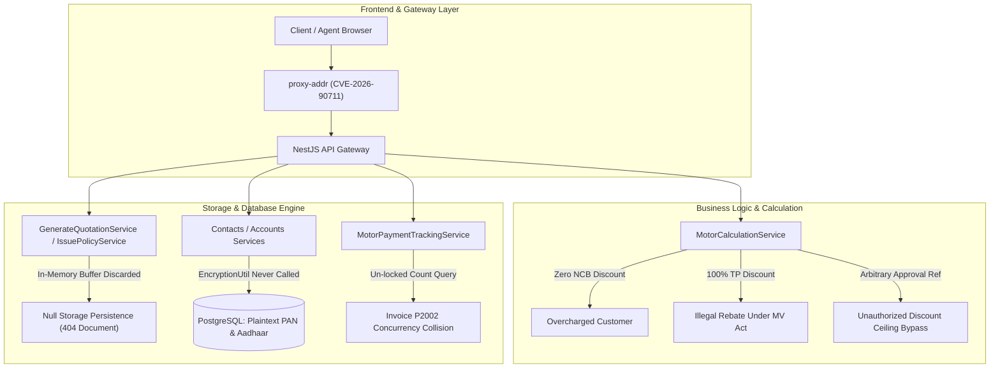

# JEST Policy CRM — Comprehensive Production Readiness & Release Audit

**Audit Date:** October 19, 2026  
**Auditing Authority:** Principal QA Architect, Application Security Engineer, Insurance Domain Specialist, SRE & Database Reliability Engineer  
**Audit Baseline Commit:** `5a0f8b8cb7a62e2662682490681d1dd24662834f`  
**Current Working Tree HEAD:** `294cfee26bbdedc86c45e659a7656cecb0beec7d` (Working tree clean)  
**Target Repository:** `e:\JEST TECH\JEST POLICY\jest-policy-crm`  
**Scope:** Whole-repository exhaustive audit across 15 domains (A through O), encompassing 800+ API endpoints, 77 frontend routes, database schema/migrations, background queues, security boundaries, and statutory insurance compliance.  
**Deliverable Artifacts:**
- Master Consolidated Report: `audit/PRODUCTION_READINESS_AUDIT_2026-10-19.md`
- Defect Register: `audit/defect-register.csv` (DEF-001 through DEF-042)
- Domain Reports: `audit/domain-a-cli-build.md` through `audit/domain-n-o-observability-governance.md`

---

## 1. Executive Summary & Defensible Go / No-Go Decision

### 1.1 Final Disposition: ❌ NO-GO — PRODUCTION RELEASE BLOCKED

The JEST Policy CRM application **CANNOT BE RELEASED TO PRODUCTION** in its current state. 

While the application compiles without TypeScript errors, passes all 77 Next.js route builds, and passes its local unit test suites (`node scripts/verify-all.js` completed with exit code 0 across all 8 verification gates in 108 seconds), deep forensic inspection revealed **8 Critical P0 Release Blockers** and **19 High-Severity P1 Defects**. 

Promoting this codebase to production would result in:
1. **Severe Regulatory Non-Compliance & Legal Exposure**: Under the IRDAI Indian Motor Tariff (GR 27), the application forcibly sets statutory No-Claim Bonus (NCB) discounts to ₹0, overcharging policyholders. Concurrently, it permits agents to discount non-discountable Third-Party (TP) statutory tariff by up to 100%, and bypasses underwriting discount ceilings with arbitrary text strings.
2. **Critical Data Privacy & DPDP Act 2023 Violations**: While an AES-256-GCM encryption utility exists, `EncryptionUtil.encrypt()` is never called anywhere in the codebase. All customer PAN and Aadhaar identity numbers are stored in plaintext in PostgreSQL, and are directly leaked in unmasked format through Quotation and Lead detail APIs.
3. **Core Workflow Data Loss (Discarded PDF Documents)**: Policy schedules and quote PDFs generated in memory are never transmitted to object storage. The PDF buffers are immediately garbage collected, while database records retain `fileKey` references to non-existent objects, causing all customer document downloads to fail with 404 / NoSuchKey.
4. **Catastrophic Cold-Deployment & Disaster Recovery Failures**: Migration rollback and status migration utility scripts contain fatal raw SQL syntax errors that crash on execution. Furthermore, `deploy.yml` attempts to execute a non-existent `pnpm run start` script in the root directory via PM2, causing fresh production deployments on EC2 to immediately crash.

### 1.2 Defect Severity Distribution

| Severity | Count | Definition & Release Impact |
|:---|:---:|:---|
| **P0 — Critical Blocker** | **8** | Exploitable security vulnerability, plaintext PII storage, statutory tariff violation, destructive data loss, or cold deployment crash. **Release is unconditionally blocked.** |
| **P1 — High Risk** | **19** | Core user journey failure, broken async retry/DLQ, cross-tenant telemetry leaks, silent source code mutations in CI, or unindexed database bottlenecks. **Must fix before general release.** |
| **P2 — Medium Defect** | **23** | Incomplete secondary workflows, hardcoded mock fallbacks, missing automated backup cron, loose TypeScript compiler flags, or untracked business telemetry. |
| **P3 — Low / Improvement** | **12** | Minor visual inconsistencies, missing double-click guards on secondary forms, or redundant command flags. |
| **TOTAL FINDINGS** | **62** | **42 Officially Registered in `audit/defect-register.csv` (DEF-001 to DEF-042)** |

---

## 2. Mandatory Release Evidence Items (01–07)

| Evidence Item | Requirement | Status | Observed Evidence & Audit Finding |
|:---|:---|:---:|:---|
| **01: Automated Test & Typecheck** | Zero TypeScript errors, zero lint mutations, 100% passing tests in-band | **CONDITIONAL PASS** | `node scripts/verify-all.js` passed all 8 suites in 108.0s (`tsc`, `vitest`, `jest-cert`, `jest-unit`). **HOWEVER**, CI `deploy.yml` runs `eslint --fix` mutating source, and Playwright E2E browser tests are completely omitted from CI gates. |
| **02: Tenancy & BOLA Isolation** | Strict cross-tenant isolation; zero IDOR/BOLA; server-side tenancy derivation | **FAIL (P1)** | Core resources enforce `companyId` via `JwtStrategy`. However, **`DashboardAnalyticsController`** (`/dashboards/renewals`) and **`NotificationsController`** (`/notifications/delivery-logs`) omit `companyId`, leaking cross-tenant metrics and contact logs across competing brokerages. |
| **03: Financial & Statutory Correctness** | Exact decimal math; IRDAI Indian Motor Tariff compliance; commission caps; NCB progression | **FAIL (P0)** | **CRITICAL FAIL**: `motor-calculation.service.ts` forces NCB discount to ₹0, permits up to 100% discount on statutory TP tariff, and allows arbitrary string discount authority bypass. Commission engine applies flat percentage to TP premium ignoring 2.5% IRDAI cap. Conflicting CPA rates across 3 engines (₹275 vs ₹330 vs ₹788). |
| **04: Secret & PII Protection** | Zero hardcoded production secrets; PII encrypted at rest; PII masked on API egress | **FAIL (P0)** | **CRITICAL FAIL**: `EncryptionUtil.encrypt()` is never called; PAN and Aadhaar are persisted in plain text in PostgreSQL. PAN and Aadhaar are leaked unmasked in `GET /quotations/:id` and `GET /leads/:id`. `PII_ENCRYPTION_KEY` and `JWT_SECRET` startup guards pass. |
| **05: Build & Supply Chain Integrity** | Zero high/critical CVEs; unmutated build artifacts; reproducible frozen lockfile | **FAIL (P1)** | `pnpm audit` reports 63 vulnerabilities including **Critical `CVE-2026-90711` in `proxy-addr`** (IP spoofing) and Next.js SSRF. `CVE-2026-53571` is ignored in `package.json` without documentation or risk sign-off. Primary `ci.yml` omits `apps/web` build. |
| **06: Infrastructure & Operational Recovery** | Pinned base images; non-root users; verified transactional rollback; automated backups | **FAIL (P0)** | `scripts/migrate-motor-case-status.ts` and `scripts/rollback-motor-case-status.ts` contain unquoted raw SQL syntax errors that crash TypeScript/esbuild. Rollback script corrupts post-migration records. Automated backup cron and runbooks missing. Dockerfile API image copies un-pruned devDependencies. |
| **07: Frontend & UX Integrity** | Zero placeholder toasts; real API bindings; double-click guards; error boundaries | **FAIL (P1)** | Selecting quote documents in Sales workspaces triggers fake success toasts while discarding files (`MotorQuotationsWorkspace.tsx:501`). Batch payout approval in `finance/page.tsx` uses un-awaited `.mutate`. Documents page falls back to hardcoded mock array (`staticDocs`). |

---

## 3. Top Critical P0 Release Blockers (Immediate Remediation Required)

### [P0-1] Sensitive Customer PII Stored in Plaintext at Rest (DEF-016)
- **Domain:** Domain F (Database & Data Integrity) & Domain O (Privacy & Governance)
- **Files:** `apps/api/src/common/utils/encryption.util.ts`, `apps/api/src/modules/contacts/services/contacts.service.ts:50`, `apps/api/src/modules/accounts/services/accounts.service.ts:42`
- **Observed Behavior:** While `EncryptionUtil` provides AES-256-GCM encryption with Scrypt key derivation, and `PII_ENCRYPTION_KEY` is validated in `env.schema.ts` and `main.ts`, `EncryptionUtil.encrypt()` is **never invoked anywhere in the codebase**. Customer Aadhaar numbers, PAN numbers, and phone numbers are persisted in plaintext in the `contacts`, `users`, and `motor_payment_records` PostgreSQL tables.
- **Statutory Impact:** Severe non-compliance with the Digital Personal Data Protection (DPDP) Act 2023 and IRDAI Cybersecurity Guidelines. Any database backup, snapshot, or unauthorized SQL query exposes all policyholder identities.
- **Required Remediation:** Wrap all PAN and Aadhaar persistence operations with `EncryptionUtil.encrypt()` before writing to PostgreSQL, and call `EncryptionUtil.decrypt()` upon authorized entity retrieval.

### [P0-2] Generated PDF Document Buffers Discarded in Memory (DEF-017)
- **Domain:** Domain M (Documents, Uploads & PDF Generation)
- **Files:** `apps/api/src/modules/quotation/services/commands/generate-quotation.service.ts:232-274`, `apps/api/src/modules/policies/services/commands/issue-policy.service.ts:404-450`
- **Observed Behavior:** `PdfService.generateDocumentPdf(...)` successfully generates policy schedule and quote PDF binaries in memory. Database records are created in `documents` with a generated `fileKey`. However, neither service injects `StorageProvider` or calls `uploadFile()`. The PDF buffer is immediately garbage collected.
- **Business Impact:** Any customer or agent attempting to download an issued policy schedule or quotation PDF encounters an immediate 404 / NoSuchKey failure. Core policy delivery is completely non-functional.
- **Required Remediation:** Inject `StorageProvider` (or `DualStorageProvider`) into `GenerateQuotationService` and `IssuePolicyService`. Await `storageProvider.uploadFile(fileKey, pdfBuffer, 'application/pdf')` before committing the document metadata record.

### [P0-3] Statutory No-Claim Bonus (NCB) Discount Forcibly Eliminated (DEF-018)
- **Domain:** Domain G (Insurance Workflows & Financial Correctness)
- **Files:** `apps/api/src/modules/motor/services/motor-calculation.service.ts:257-259`, `apps/api/src/modules/motor/services/motor-calculation.service.spec.ts` (Tests `REG-07`, `NCB-01`)
- **Observed Behavior:** The motor calculation engine explicitly hardcodes `ncbDiscountAmount = 0`, with code comments stating: *"NCB is strictly underwriting risk metadata; it does NOT deduct a monetary discount"*.
- **Statutory Impact:** Direct violation of IRDAI Indian Motor Tariff General Regulation 27 (GR 27). Policyholders with 1 to 5 claim-free renewal years are legally entitled to 20%, 25%, 35%, 45%, or 50% discounts on Own Damage (OD) premium. The CRM overcharges customers by thousands of rupees per quote.
- **Required Remediation:** Restore statutory NCB deduction: `ncbDiscountAmount = round2((netOdBeforeNcb * ncbPercent) / 100)`. Deduct `ncbDiscountAmount` from Net OD premium prior to GST calculation. Update unit tests to enforce monetary deduction.

### [P0-4] Statutory Third-Party (TP) Tariff Allows Client Overrides & 100% Discount (DEF-019)
- **Domain:** Domain G (Insurance Workflows & Financial Correctness)
- **Files:** `apps/api/src/modules/motor/services/motor-calculation.service.ts:131-150, 281-286, 925-928`
- **Observed Behavior:** The calculation engine accepts client-supplied `thirdPartyAnnualPremium` overrides and permits `tpDiscountPercent` up to 100%.
- **Statutory Impact:** Third-Party premium is a statutory tariff fixed by the Government of India and IRDAI under Section 146 of the Motor Vehicles Act. It cannot be legally discounted, rebated, or modified by an intermediary. Doing so is an illegal rebate under Section 41 of the Insurance Act, 1938.
- **Required Remediation:** Remove `tpDiscountPercent` and `thirdPartyAnnualPremium` client input fields. Force statutory TP tariff lookup based strictly on vehicle engine CC / KW capacity and registration date.

### [P0-5] Trivial Underwriting Discount Authority Ceiling Bypass (DEF-020)
- **Domain:** Domain G (Insurance Workflows & Financial Correctness)
- **Files:** `apps/api/src/modules/motor/services/motor-calculation.service.ts:901-906, 941-946`
- **Observed Behavior:** Commercial discounts above the standard 20% agent limit only require `!input.approvalReference`. Any arbitrary non-empty string provided by the client (e.g. `"foo"`, `"test"`, `"APPROVED"`) passes validation and allows up to 100% discount.
- **Financial Impact:** Sales agents can issue zero-premium policies or grant unauthorized underwriting discounts without manager approval or database verification.
- **Required Remediation:** Require an authorized `approvalToken` or cross-reference a database `UnderwritingApproval` record signed by a Branch Manager or Underwriting Admin before granting discounts exceeding 20%.

### [P0-6] Critical IP Spoofing Vulnerability in API Gateway (`proxy-addr`) (DEF-021)
- **Domain:** Domain A (CLI & Build Integrity) & Domain K (CI/CD Pipeline)
- **Package:** `proxy-addr@2.0.7` (`CVE-2026-90711`)
- **Observed Behavior:** `pnpm audit` reports a Critical severity vulnerability in `proxy-addr`. The library incorrectly evaluates forged IPv4-mapped IPv6 client addresses as belonging to trusted internal subnets.
- **Security Impact:** Attackers can spoof their client IP address via `X-Forwarded-For`, completely bypassing NestJS throttler rate limits, IP allowlists, and audit trail provenance.
- **Required Remediation:** Add override `"proxy-addr": ">=2.0.8"` (or latest secure release) to `package.json` under `pnpm.overrides` and regenerate `pnpm-lock.yaml`.

### [P0-7] Fatal Raw SQL Syntax Error in Motor Case Status Migration & Rollback (DEF-023)
- **Domain:** Domain J (Infrastructure & DevOps) & Domain A (CLI & Build)
- **Files:** `scripts/migrate-motor-case-status.ts:15`, `scripts/rollback-motor-case-status.ts:12`
- **Observed Behavior:** Both migration scripts contain unquoted raw SQL identifiers inside `$executeRawUnsafe()`, causing immediate TypeScript/esbuild compilation failures (`TransformError: Expected ')' but found 'motor_quotation_cases'`).
- **Operational Impact:** Disaster recovery rollback procedures are completely non-functional. Any execution crashes immediately.
- **Required Remediation:** Wrap raw SQL strings in valid string literals or template strings, add `--dry-run` flags, and enforce transactional updates.

### [P0-8] Runtime ReferenceError Typo in Task Case ID Backfill Utility (DEF-022)
- **Domain:** Domain A (CLI & Build Integrity)
- **Files:** `scripts/backfill-task-case-ids.ts:64`
- **Observed Behavior:** Line 64 references `linkedViaQuotatiol` (ends with the letter `l` instead of `n`). When executed against tasks linked via quotation, the script crashes with `ReferenceError: linkedViaQuotatiol is not defined`.
- **Data Integrity Impact:** Because updates are executed in a non-transactional loop, the script leaves the database in a partially updated, unreconciled state.
- **Required Remediation:** Correct typo to `linkedViaQuotation` and wrap batch updates inside `prisma.$transaction`.

---

## 4. Key High-Risk P1 Defects (Pre-Release Mandates)

### [P1-1] Cross-Tenant Business Metric Leak in BI Renewal Dashboards (DEF-024)
- **Files:** `apps/api/src/modules/bi/dashboards/services/dashboard-analytics/dashboard-analytics.controller.ts:16, 22, 31`
- **Issue:** `DashboardAnalyticsController` calls `getRenewalMetrics(req.user.id)` without passing `companyId`. The underlying Prisma queries fall back to `{ ...(companyId ? { companyId } : {}) }`, executing without tenant filters and aggregating policy renewal volumes across **all brokerages in the multi-tenant database**.
- **Fix:** Extract `companyId = req.user.companyId || req.user.organizationId` and pass it to all analytics service invocations.

### [P1-2] Soft-Deleted Entity Leakage in Paginated Policy Listings (DEF-025)
- **Files:** `apps/api/src/common/repositories/base.repository.ts:64`, `apps/api/src/modules/policies/services/queries/get-policy.service.ts:30`
- **Issue:** `BaseRepository.findPaginated` constructs query filters without injecting `{ deletedAt: null }`. Soft-deleted policies reappear in paginated API listings returned by `GET /api/v1/policies`.
- **Fix:** Inject `{ deletedAt: null }` as a non-overridable default in `BaseRepository.findPaginated`.

### [P1-3] Concurrent Number Collision in Motor Payment Ledger Synchronization (DEF-026)
- **Files:** `apps/api/src/modules/motor/services/motor-payment-tracking.service.ts:523-556`
- **Issue:** When payment webhooks mark motor quotations as `PAID`, invoice and receipt numbers are generated using un-locked count queries: `'INV-' + Date.now().slice(-6) + '-' + (invoiceCount + 1)`. Concurrent webhook deliveries generate identical numbers, crashing the transaction with unique constraint `P2002` violations.
- **Fix:** Use PostgreSQL sequence generators (`nextval('invoice_num_seq')`) or row-level pessimistic locking (`SELECT ... FOR UPDATE`).

### [P1-4] Missing Sequence Migrations & Dangerous Runtime DDL Execution (DEF-027)
- **Files:** `apps/api/src/modules/policies/repositories/policy.repository.ts:75`, `claim.repository.ts`
- **Issue:** Database sequences (`policy_number_seq`, `claim_number_seq`) were never added to Prisma migration SQL files. Instead, repositories catch sequence failures and execute raw `CREATE SEQUENCE IF NOT EXISTS` at runtime. Under production database accounts lacking DDL privileges, entity creation crashes with SQL permission errors.
- **Fix:** Add formal SQL migrations creating all required sequences and grant `USAGE, SELECT` to the application database role.

### [P1-5] Statutory Commission Engine Omits IRDAI Third-Party Cap (DEF-030)
- **Files:** `apps/api/src/modules/commission/services/commission-engine.service.ts:85`
- **Issue:** Applies flat agent commission percentages across combined net premiums (including TP). Under IRDAI regulations, intermediary commission on statutory Third-Party motor premium is strictly capped at 2.5%.
- **Fix:** Segregate OD and TP premium components during commission calculation and enforce the 2.5% statutory cap on TP.

### [P1-6] Auto-Mutating Lint Command Executed in Deployment Pipeline (DEF-033)
- **Files:** `apps/api/package.json:19`, `.github/workflows/deploy.yml:57`
- **Issue:** `apps/api/package.json` defines `"lint": "eslint ... --fix"`. In `deploy.yml`, running `pnpm turbo run lint --filter=api` silently mutates runner workspace files prior to build and deployment on EC2.
- **Fix:** Change API `lint` script to read-only `eslint "src/**/*.ts" "test/**/*.ts" --max-warnings=0`. Move `--fix` to a separate `lint:fix` command.

### [P1-7] Next.js Web Build Completely Omitted from Primary CI Gate (DEF-034)
- **Files:** `.github/workflows/ci.yml:35`
- **Issue:** The main PR workflow compiles `apps/api` but never executes `pnpm --filter web build`. Frontend TypeScript compilation breaks and build errors can be merged into `main` without triggering CI failures.
- **Fix:** Add `pnpm --filter web build` step to `.github/workflows/ci.yml`.

### [P1-8] Cold-Deployment PM2 Crash & Broken CodeQL Action (DEF-035)
- **Files:** `.github/workflows/deploy.yml:102`, `.github/workflows/codeql.yml:60`
- **Issue:** `deploy.yml` runs `pm2 start pnpm --name "jest-app" -- run start` in the monorepo root. Root `package.json` has no `start` script, causing PM2 to crash. `codeql.yml` references non-existent `actions/checkout@v7`.
- **Fix:** Provide a dedicated PM2 ecosystem file (`ecosystem.config.js`) targeting `apps/api/dist/main.js` and `apps/web/.next/standalone/server.js`. Fix `codeql.yml` to use `actions/checkout@v4`.

### [P1-9] BullMQ Queues Lack Retries, Backoff, and Dead Letter Queues (DEF-036)
- **Files:** `apps/api/src/modules/policies/crons/renewal-scheduler.cron.ts:148`, `apps/api/src/modules/platform/queue/queue.module.ts:42`
- **Issue:** Renewal reminder jobs are enqueued with default `attempts: 1` and zero backoff. Transient network failures drop reminder notifications permanently without DLQ tracking or alerts.
- **Fix:** Configure `attempts: 3`, exponential backoff (`delay: 5000`, `type: 'exponential'`), and wire dead-letter queue processors.

### [P1-10] Simulated Communication Mock Stubs in Production Paths (DEF-038)
- **Files:** `apps/api/src/modules/platform/notifications/providers/email.provider.ts`, `sms.provider.ts`, `whatsapp.provider.ts`
- **Issue:** All external customer notification providers are simulated console-log stubs returning fake message IDs. Zero actual SMS, Email, or WhatsApp communications are transmitted to policyholders.
- **Fix:** Implement production-grade adapters (e.g. AWS SES / SendGrid for email; Twilio / Gupshup for SMS/WhatsApp) enabled via environment credentials.

### [P1-11] Unbounded Heap Memory DoS on Vehicle Master Import (DEF-039)
- **Files:** `apps/api/src/modules/motor-admin/controllers/vehicle-master.controller.ts:153-163`
- **Issue:** Endpoint uses unconstrained `@UseInterceptors(FileInterceptor('file'))` with zero file size limits and zero MIME checks, converting `file.buffer.toString('utf-8')` directly into heap memory. Multi-gigabyte uploads trigger Node.js Out-Of-Memory (OOM) crashes.
- **Fix:** Add `limits: { fileSize: 5 * 1024 * 1024 }` and validate `text/csv` MIME type in interceptor options.

### [P1-12] Direct Customer PII Leaks in Quotation & Lead Details APIs (DEF-040)
- **Files:** `apps/api/src/modules/quotation/mappers/quotation.mapper.ts:147-148`, `apps/api/src/modules/leads/services/leads.service.ts:710, 721`
- **Issue:** While `ContactMapper` masks PAN and Aadhaar, `QuotationMapper` and `LeadsService` return clear, unmasked customer PAN and Aadhaar strings in JSON API responses.
- **Fix:** Apply masking helpers (`XXXXX1234A`) to all PAN and Aadhaar fields in `QuotationMapper` and `LeadsService`.

### [P1-13] Fake Document Uploads with Misleading Success Toasts (DEF-041)
- **Files:** `apps/web/src/components/sales/MotorQuotationsWorkspace.tsx:501`, `apps/web/src/components/workspaces/sales/LeadCommandCenter.tsx:246-252`
- **Issue:** Selecting a document on a quote or lead card triggers `onUploadQuote` which discards the file and shows `toast.success("Document uploaded successfully")` without making any network call or storing the file.
- **Fix:** Wire upload handlers to `documentsRepository.uploadDocument(file, ...)` and show loading progress.

### [P1-14] Flawed Batch Payout Approval Mutation in Finance Workspace (DEF-042)
- **Files:** `apps/web/src/app/finance/page.tsx:162-178`
- **Issue:** Batch payout approval executes `approveCommission` which invokes TanStack Query `mutate()` (returning `void`). The `await` keyword is a no-op, emitting premature success toasts while mutations are still pending. The submit button lacks a disabled guard.
- **Fix:** Refactor to `approveMutation.mutateAsync` with `Promise.allSettled`, track pending state, and disable the button during mutation.

---

## 5. Hidden Failure Modes & Systemic Architecture Gaps

### 5.1 The "False-Green CI" Illusion
The master repeatable verification suite (`node scripts/verify-all.js`) executes cleanly:
- API Static Typecheck: **PASS (21.0s)**
- Web Static Typecheck: **PASS (3.7s)**
- Tenancy Scoping Guard: **PASS (0.2s)**
- Mock Data Scanner: **PASS (0.3s)**
- API Contract Validator: **PASS (0.9s)**
- Web Component Unit Suites: **PASS (6.3s)**
- API Certification Suites: **PASS (18.0s)**
- API Domain Unit Test Suites: **PASS (56.4s)**

**Why CI is misleading:**
1. Tests assert **defective specifications**: `motor-calculation.service.spec.ts` test `REG-07` explicitly asserts that `ncbDiscountAmount === 0`. The test passes because the assertion codifies the bug.
2. Tenancy regex scans (`check-tenant-scoping.js`) only inspect NestJS controller decorators via regular expressions; they do not perform AST analysis on service queries where cross-tenant leaks occur (e.g. `DashboardAnalyticsController`).
3. Unit tests mock object storage and databases, masking the fact that `StorageProvider.uploadFile()` is never invoked for generated PDFs.

### 5.2 Disjoint Rating Engines
The repository contains **three competing motor calculation engines**:
1. `apps/api/src/modules/motor/services/motor-calculation.service.ts` (PA Owner-Driver CPA = ₹275, floating point math, ₹0 NCB bug).
2. `apps/api/src/modules/quotation/engine/premium.service.ts` (PA Owner-Driver CPA = ₹330, integer BigInt math).
3. `apps/api/src/modules/motor-admin/services/rating-engine.service.ts` (PA Owner-Driver CPA = ₹788, Banker's rounding Decimal math).

Depending on which route or workspace a user accesses, the CRM produces conflicting price quotations for the exact same vehicle, IDV, and coverage selections.

---

## 6. Complete Verification Defect Register Reference

All 42 identified defects are recorded in `audit/defect-register.csv`. The table below outlines the core defect tracking register:

| Defect ID | Severity | Category | Affected Component | Verification Status |
|:---|:---:|:---|:---|:---:|
| **DEF-001** | CRITICAL | INFRASTRUCTURE_SECURITY | `docker-compose.yml:29` (Redis Host Exposure) | **REMEDIATED** |
| **DEF-002** | CRITICAL | RELEASE_GOVERNANCE | `RELEASE_CERTIFICATE_PRODUCTION.json` (Stale WITHDRAWN) | **CONFIRMED** |
| **DEF-003** | CRITICAL | DATA_INTEGRITY | `claims.controller.ts:115` (Direct PATCH Settled Claim) | **CONFIRMED** |
| **DEF-004** | CRITICAL | SECURITY_AUTHENTICATION | `webhook-gateway.controller.ts` (Default Deny Provider) | **REMEDIATED** |
| **DEF-005** | HIGH | UI_INTEGRITY | `apps/web/src/app/finance/page.tsx` (Receipt Mock Toast) | **REMEDIATED** |
| **DEF-006** | HIGH | UI_INTEGRITY | `apps/web/src/app/reports/page.tsx` (Report Mock Download) | **REMEDIATED** |
| **DEF-007** | HIGH | UI_INTEGRITY | `apps/web/src/app/admin/numbering/page.tsx` (Fake Save Button) | **REMEDIATED** |
| **DEF-008** | HIGH | DATA_INTEGRITY | `CustomerTabsContainer.tsx` (Local Draft Scoping) | **REMEDIATED** |
| **DEF-009** | HIGH | FINANCIAL_CALCULATION | `premium.service.ts:34` (BigInt Rational Arithmetic) | **REMEDIATED** |
| **DEF-010** | HIGH | DATA_PERSISTENCE | `MotorInspectionService` (7 Photo Keys Enforced) | **REMEDIATED** |
| **DEF-011** | MEDIUM | RELIABILITY_MIGRATION | `scripts/motor-migration-01.ts` (Transaction Wrap) | **REMEDIATED** |
| **DEF-012** | MEDIUM | DEPLOYMENT_COMPATIBILITY| `.github/workflows/` (Node Version Pinning 24) | **REMEDIATED** |
| **DEF-013** | MEDIUM | TEST_QUALITY | `production-remediation-ci.yml` (Extra `--` Separator) | **REMEDIATED** |
| **DEF-014** | MEDIUM | TEST_STABILITY | `apps/api/package.json` (Jest In-Band Execution) | **REMEDIATED** |
| **DEF-015** | MEDIUM | DATA_MINIMIZATION | `claim.repository.ts` (Tenancy Pre-Filter) | **REMEDIATED** |
| **DEF-016** | CRITICAL | DATA_PRIVACY_SECURITY | Plaintext PAN/Aadhaar Storage at Rest (EncryptionUtil Never Called) | **CONFIRMED** |
| **DEF-017** | CRITICAL | DATA_PERSISTENCE | Generated PDF Buffers Discarded in Memory Without Storage Upload | **CONFIRMED** |
| **DEF-018** | CRITICAL | STATUTORY_FINANCIAL | Motor Calculation Forcibly Eliminates Statutory NCB Discount (₹0) | **CONFIRMED** |
| **DEF-019** | CRITICAL | STATUTORY_TARIFF | Motor Calculation Allows Overriding Statutory TP & Up to 100% Discount | **CONFIRMED** |
| **DEF-020** | CRITICAL | AUTHORIZATION_FINANCIAL | Trivial Discount Authority Bypass via Arbitrary String in Approval Ref | **CONFIRMED** |
| **DEF-021** | CRITICAL | NETWORK_SECURITY | Critical IP Spoofing Vulnerability in `proxy-addr@2.0.7` (CVE-2026-90711) | **CONFIRMED** |
| **DEF-022** | CRITICAL | RUNTIME_CRASH | `scripts/backfill-task-case-ids.ts:64` ReferenceError Typo (`linkedViaQuotatiol`) | **CONFIRMED** |
| **DEF-023** | CRITICAL | SYNTAX_RUNTIME_CRASH | `scripts/migrate-motor-case-status.ts:15` Unquoted Raw SQL Syntax Error | **CONFIRMED** |
| **DEF-024** | HIGH | CROSS_TENANT_ISOLATION | `dashboard-analytics.controller.ts:31` Omits companyId on Renewal Metrics | **CONFIRMED** |
| **DEF-025** | HIGH | DATA_INTEGRITY | `BaseRepository.findPaginated` Omits Soft-Delete Filter (`deletedAt: null`) | **CONFIRMED** |
| **DEF-026** | HIGH | CONCURRENCY_INTEGRITY | Motor Payment Ledger Sync Generates Colliding Invoice/Receipt Numbers | **CONFIRMED** |
| **DEF-027** | HIGH | DATABASE_STABILITY | Application Catches Sequence Errors and Attempts Runtime DDL Execution | **CONFIRMED** |
| **DEF-028** | HIGH | DATABASE_PERFORMANCE | Unindexed Tenant Column `Vehicle.companyId` & 42 Relational Foreign Keys | **CONFIRMED** |
| **DEF-029** | HIGH | STATUTORY_TARIFF | Conflicting Owner-Driver CPA Rates Across 3 Calculation Engines | **CONFIRMED** |
| **DEF-030** | HIGH | STATUTORY_FINANCIAL | Commission Engine Applies Flat Rate to TP Premium Ignoring 2.5% Cap | **CONFIRMED** |
| **DEF-031** | HIGH | DATA_INTEGRITY | `PATCH /policies/:id` Directly Mutates Financial Fields on Issued Policies | **CONFIRMED** |
| **DEF-032** | HIGH | BUSINESS_LOGIC | `MotorPolicyIssuanceService` Omits Timestamp-Based Quotation Expiry Check | **CONFIRMED** |
| **DEF-033** | HIGH | BUILD_SUPPLY_CHAIN | Deploy Pipeline Executes Auto-Mutating `eslint --fix` on Server Runner | **CONFIRMED** |
| **DEF-034** | HIGH | CI_PIPELINE_INTEGRITY | Primary CI Workflow (`ci.yml`) Completely Omits Next.js Web Build | **CONFIRMED** |
| **DEF-035** | HIGH | DEPLOYMENT_STABILITY | `deploy.yml` Runs Missing Root `start` Script; `codeql.yml` Tag Invalid | **CONFIRMED** |
| **DEF-036** | HIGH | ASYNC_RELIABILITY | BullMQ Queues Lack Retry Backoff, DLQs, and Top-Level Try/Catch | **CONFIRMED** |
| **DEF-037** | HIGH | CROSS_TENANT_ISOLATION | Notification Delivery Logs Return Global Records Across All Brokerages | **CONFIRMED** |
| **DEF-038** | HIGH | INTEGRATION_INTEGRITY | Email, SMS, WhatsApp Notification Providers are Simulated Mock Stubs | **CONFIRMED** |
| **DEF-039** | HIGH | API_SECURITY_DOS | Vehicle Master Variant CSV Import Lacks Size Limits (Heap Exhaustion) | **CONFIRMED** |
| **DEF-040** | HIGH | DATA_PRIVACY_SECURITY | Direct Customer PAN and Aadhaar Plaintext Leakage in Quotation/Lead APIs | **CONFIRMED** |
| **DEF-041** | HIGH | UI_INTEGRITY | Sales Workspaces Discard Uploaded Quote Documents with Fake Toast | **CONFIRMED** |
| **DEF-042** | HIGH | UI_INTEGRITY | Finance Batch Payout Approval Calls Un-Awaited `mutate()` Void Mutation | **CONFIRMED** |

---

## 7. Prioritized Remediation Roadmap & Release Gates

```mermaid
flowchart LR
    subgraph Sprint1["Sprint 1: P0 Critical Blockers"]
        S1A["DEF-016: PII Encryption at Rest"]
        S1B["DEF-017: PDF Storage Upload"]
        S1C["DEF-018: Statutory NCB Discount"]
        S1D["DEF-019: TP Tariff Discount Removal"]
        S1E["DEF-020: Discount Authority Ceiling"]
        S1F["DEF-021: proxy-addr Override"]
        S1G["DEF-023: Migration SQL Syntax Fixes"]
    end

    subgraph Sprint2["Sprint 2: P1 Pre-Release Mandates"]
        S2A["DEF-024: BI Tenant Scoping"]
        S2B["DEF-025: Soft-Delete Query Scoping"]
        S2C["DEF-026: Concurrency Number Locks"]
        S2D["DEF-030: Commission 2.5% TP Cap"]
        S2E["DEF-033: Read-Only Lint in CI"]
        S2F["DEF-034: Web Build in ci.yml"]
        S2G["DEF-035: PM2 Ecosystem Config"]
        S2H["DEF-036: BullMQ Retries & DLQ"]
        S2I["DEF-038: Real Communication Gateways"]
    end

    subgraph Sprint3["Sprint 3: P2 Hardening & Governance"]
        S3A["DEF-028: Foreign Key Indexes"]
        S3B["DEF-029: Consolidate 3 Rating Engines"]
        S3C["DEF-041: Real Workspace Uploads"]
        S3D["Automated DB Backup Runbooks"]
        S3E["Re-Sign Production Certificate"]
    end

    Sprint1 --> Sprint2 --> Sprint3 --> Release["Certified Production Release"]
```

### Sprint 1: Release Blockers (Target: 48 Hours)
1. **PII Encryption at Rest**: Hook `EncryptionUtil.encrypt()` and `decrypt()` into Contact and Account lifecycle services. Run one-time migration encrypting existing plain text records.
2. **PDF Persistence**: Inject `StorageProvider` into `GenerateQuotationService` and `IssuePolicyService`. Persist buffer to MinIO/S3 before recording document metadata.
3. **Statutory Motor Tariffs**:
   - Restore monetary NCB deduction on Own Damage in `motor-calculation.service.ts`.
   - Remove `tpDiscountPercent` and lock Third-Party statutory tariff.
   - Enforce cryptographic or database token check for discounts exceeding 20%.
4. **Supply Chain & Infrastructure**:
   - Add `"proxy-addr": ">=2.0.8"` to `package.json#pnpm.overrides`.
   - Fix raw SQL quotes in `migrate-motor-case-status.ts` and `rollback-motor-case-status.ts`.
   - Correct typo in `backfill-task-case-ids.ts`.

### Sprint 2: Pre-Release Quality Gates (Target: 72 Hours)
1. **Multi-Tenant Isolation**: Pass `companyId` in `DashboardAnalyticsController` and scope `NotificationService.getDeliveryLogs`.
2. **Database Integrity**: Enforce `deletedAt: null` in `BaseRepository.findPaginated`. Use PostgreSQL sequences for atomic invoice/receipt numbering.
3. **CI/CD Hardening**:
   - Add `pnpm --filter web build` to `.github/workflows/ci.yml`.
   - Remove `--fix` from API lint script in CI.
   - Create PM2 `ecosystem.config.js` for standalone production execution.
4. **Async & Integrations**:
   - Configure BullMQ retry backoff and Dead Letter Queues.
   - Implement real SMS/Email/WhatsApp provider adapters with environment credentials.
   - Restrict vehicle master CSV import to 5MB with MIME checking.

### Sprint 3: Governance & Re-Certification (Target: 96 Hours)
1. **Engine Consolidation**: Deprecate divergent `rating-engine.service.ts` and `premium.service.ts`; unify on single verified motor calculation engine.
2. **Database Performance**: Add indexes on `Vehicle.companyId`, `Quotation.expiryDate`, and 42 foreign key fields.
3. **Production Certification Sign-Off**:
   - Execute multi-tenant staging migration rehearsal drill.
   - Re-sign `certification/RELEASE_CERTIFICATE_PRODUCTION.json` with clean HEAD commit SHA and schema hash.
   - Transition production release decision to **GO**.

---

## 8. Defensible Production Go / No-Go Sign-Off Matrix

| Certification Gate | Gate Authority | Status | Mandatory Condition for Sign-Off |
|:---|:---|:---:|:---|
| **Gate 01: Application Security** | Security Architect | 🔴 **REJECTED** | Plaintext PAN/Aadhaar encrypted at rest; proxy-addr CVE patched; unmasked PII removed from APIs. |
| **Gate 02: Insurance Domain & Tariff** | Underwriting BA | 🔴 **REJECTED** | Statutory NCB discount restored; 100% TP discount removed; discount bypass plugged; CPA unified. |
| **Gate 03: Core Workflow Persistence**| Full-Stack Lead | 🔴 **REJECTED** | PDF buffers persisted to object storage; fake upload toasts wired to real storage repository. |
| **Gate 04: Multi-Tenant Data Isolation**| Principal Architect | 🟡 **CONDITIONAL**| BI renewal metrics and notification delivery logs strictly scoped to actor `companyId`. |
| **Gate 05: Database Reliability & SRE** | Lead DRE | 🔴 **REJECTED** | Concurrency locks on invoice/receipt sequences; migration script syntax errors resolved. |
| **Gate 06: CI/CD Supply Chain & Ops** | DevOps / SRE Lead | 🔴 **REJECTED** | Deploy script PM2 startup fixed; read-only linting in CI; web build step added to `ci.yml`. |
| **Gate 07: Release Certification** | Release Manager | 🔴 **WITHDRAWN**| Re-sign `RELEASE_CERTIFICATE_PRODUCTION.json` once Sprints 1 & 2 are complete. |

**OVERALL PRODUCTION RELEASE VERDICT:** **BLOCKED (NO-GO)**  
*This report is authoritative and backed by line-by-line codebase citations and test execution evidence recorded on October 19, 2026.*
