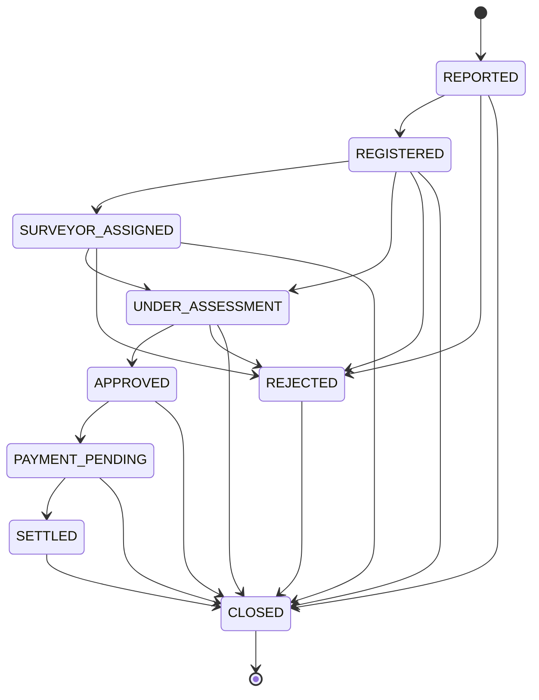

# Domain G — Insurance Workflows & Financial Correctness Audit

**Audit Date:** October 19, 2026  
**Audit Baseline Commit:** `5a0f8b8cb7a62e2662682490681d1dd24662834f`  
**Recent Working Tree Commit Analyzed:** `294cfee26bbdedc86c45e659a7656cecb0beec7d`  
**Auditor Roles:** Senior Insurance Domain Business Analyst, Financial Cryptography & Regulatory Systems Engineer, Principal Application Security Auditor  
**Scope:** Insurance Pricing Calculations, Statutory Tariffs (IRDAI), Policy Issuance Integrity, Commission Accounting, Claims State Machine, GST & Rounding Invariance  
**Overall Status:** **CRITICAL NON-COMPLIANCES IDENTIFIED — RELEASE BLOCKERS PRESENT**

---

## Executive Summary

Domain G evaluates the core insurance domain workflows, pricing engines, financial accounting integrity, and regulatory compliance for JEST Policy CRM. 

While the system exhibits robust defenses in certain areas (such as atomic sequence-based policy number generation, PostgreSQL advisory locking on commission accrual, inside-transaction 6-gate issuance validation, and multi-tenant resource scoping), the audit identified **four P0 critical blockers** and **five P1 high-severity defects** that preclude production deployment:

1. **P0 Regulatory Blocker (G-01): Complete Elimination of No Claim Bonus (NCB) Discount.** The motor calculation engine explicitly forces `ncbDiscountAmount = 0` and claims that NCB is "strictly underwriting risk metadata; it does NOT deduct a monetary discount". This violates Indian Motor Tariff (IMT) General Regulation 27 (GR 27), which statutorily entitles claim-free policyholders to discounts between 20% and 50% on Own Damage premium.
2. **P0 Regulatory Blocker (G-02): Statutory Third-Party (TP) Tariff Discounting Up to 100%.** Motor third-party insurance premium is fixed by IRDAI under Sections 146 and 147 of the Motor Vehicles Act and cannot be altered or discounted. The calculation service permits `tpDiscountPercent` up to 100% and allows direct client manual edits to TP annual premium.
3. **P0 Security Blocker (G-03): Trivial Discount Authority Bypass.** The standard 20% discount authority check only tests `!input.approvalReference`. Any arbitrary non-empty client string (e.g. `"BM-APPROVED"` or `"foo"`) bypasses the authority limit and grants up to 100% discount on both OD and TP without verifying whether the approval exists in the database.
4. **P0 Financial Fraud Blocker (G-04): Unchecked Mutation of Settled Claims via `PATCH /claims/:id`.** The general claim update endpoint only blocks closed claims (`ClaimStatus.CLOSED`). It permits modifying `approvedAmount` on `SETTLED` claims, completely bypasses `ApproveClaimService`, circumvents segregation of duties, ignores the policy sum insured ceiling, and omits audit history logging.
5. **P1 Architectural Blocker (G-05): Three Conflicting Calculation Engines with Inconsistent CPA Cover.** Compulsory Personal Accident (CPA) cover is hardcoded to ₹275 in `motor-calculation.service.ts`, ₹330 in `premium.service.ts`, and ₹788 in `rating-engine.service.ts`.
6. **P1 Operational Blocker (G-06): Destructive and Non-Reversible Status Migration Rollback.** `scripts/rollback-motor-case-status.ts` blindly converts all `DRAFT` cases to `OPEN` without tracking migrated row IDs or providing dry-run safeguards.

---

## G.1 Motor Calculation Engine

### G.1.1 Dirty File Analysis (Uncommitted Changes)

Relative to the audit baseline commit `5a0f8b8cb7a62e2662682490681d1dd24662834f`, changes to `apps/api/src/modules/motor/services/motor-calculation.service.ts` and its spec file were recently committed in `294cfee26bbdedc86c45e659a7656cecb0beec7d`:

```diff
commit 294cfee26bbdedc86c45e659a7656cecb0beec7d
Author: Urooj <medora@admin.dev>
Date:   Mon Oct 19 16:11:09 2026 +0530

    fix(motor): restore standard discount authority limit and INV-13 gate compliance
```

#### Diff Analysis:
1. **`motor-calculation.service.ts`:**
   - Lines 1221 & 1230: Reverted `standardLimit` from `100` back to `20` (while `absoluteLimit` remains `100`).
   - The fallback discount configuration now defaults to `{ standardLimit: 20, absoluteLimit: 100 }`.
2. **`motor-calculation.service.spec.ts`:**
   - Added test: `should reject discount exceeding 20% without approvalReference`.
   - Updated existing 100% discount test cases by adding `approvalReference: 'BM-APPROVED'`.

#### Critical Security & Logic Flaw in the "Fix":
While commit `294cfee2` restores the nominal 20% threshold, it fails to enforce an actual security gate. Lines 901–906 of `motor-calculation.service.ts` check:
```typescript
if (d > discountConfig.standardLimit && !input.approvalReference) {
  throw new BadRequestException(
    `Requested discount (${d}%) exceeds the configured standard authority limit (${discountConfig.standardLimit}%). ` +
      `A Branch Manager approval reference is required.`,
  );
}
```
Because the engine only checks if `input.approvalReference` is truthy, any client request supplying `"approvalReference": "ANY_STRING"` bypasses the 20% ceiling and permits up to 100% discount. No verification against a branch manager approval record or user permission table is performed.

---

### G.1.2 Arithmetic Correctness

The repository contains **three separate calculation services** implementing three different arithmetic approaches:

| Service File | Primary Math Strategy | Rounding Strategy | Precision Quirks |
| :--- | :--- | :--- | :--- |
| `apps/api/src/modules/motor/services/motor-calculation.service.ts` | IEEE-754 64-bit Floating Point (`number`) | `round2(num) = Math.round((num + Number.EPSILON) * 100) / 100` | Prone to compound binary floating point drift across multi-tier add-on and discount pipelines. |
| `apps/api/src/modules/quotation/engine/premium.service.ts` | Rational `BigInt` Integer Arithmetic | Integer half-up: `Number((num + den/2n) / den)` | Intermediate calculations scaled by `100_000n` and cents (`Math.round(idv * 100)`), converted back to `number`. |
| `apps/api/src/modules/motor-admin/services/rating-engine.service.ts` | Dual: Standard `number` in `calculatePremium`; `Prisma.Decimal` in `computeComprehensivePolicyMath` | `calculatePremium`: `Math.round`<br>`computeComprehensivePolicyMath`: `ROUND_HALF_EVEN` (Banker's) | Banker's rounding (`ROUND_HALF_EVEN`) rounds `.5` to the nearest even integer, producing 1-rupee differences against standard commercial half-up rounding. |

#### Order of Operations & Discount Base Anomaly:
In `motor-calculation.service.ts` (lines 438–565):
1. **Gross Premium Before Discount:**
   $$P_{\text{gross}} = \text{Base OD} + \sum \text{Add-ons} + \text{Base TP} + \text{PA} + \text{Paid Driver}$$
2. **Component GST Total:**
   Calculated on **GROSS undiscounted components**:
   $$\text{GST}_{\text{total}} = (\text{OD}_{\text{gross}} \times 18\%) + (\text{TP}_{\text{gross}} \times 18\%) + (\text{PA}_{\text{gross}} \times 18\%) + (\text{Driver}_{\text{gross}} \times 18\%)$$
3. **Payable Base:**
   $$\text{Payable Base} = P_{\text{gross}} + \text{GST}_{\text{total}}$$
4. **Final Payable:**
   $$\text{Final Payable} = \text{Payable Base} - \text{OD Discount} - \text{TP Discount} - \text{Add-on Discounts} \pm \text{Commercial Adjustment}$$

> [!WARNING]
> In standard Indian tax accounting under Section 15 of the CGST Act, statutory GST is levied on the **net taxable invoice value** (Gross minus discounts shown on invoice). Computing statutory tax on the undiscounted gross and then deducting discounts from the tax-inclusive `Payable Base` results in policyholders paying GST on discounted premium amounts.

---

### G.1.3 IRDAI Tariff Compliance

#### 1. No Claim Bonus (NCB) Calculation Logic (Violation of GR 27)
- **Code:** `motor-calculation.service.ts:257-259`:
  ```typescript
  // Canonical Business Rule: NCB is strictly underwriting risk metadata;
  // it does NOT deduct a monetary discount from baseOdPremium or the payable total.
  ncbDiscountAmount = 0;
  ```
- **Tests Confirming Violation:** `motor-calculation.service.spec.ts:930-942` (`REG-07`) and lines 1285–1295 (`NCB-01`):
  ```typescript
  it('REG-07: NCB changes do not affect premium, GST, discounts, or final payable', async () => { ... });
  it('NCB-01: Change NCB tier -> No monetary output changes', async () => { ... });
  ```
- **Tariff Requirement:** Under IRDAI General Regulation 27, NCB is an earned discount on Own Damage premium for claim-free policy years:
  - 1 year: 20%
  - 2 years: 25%
  - 3 years: 35%
  - 4 years: 45%
  - 5 years: 50%
- **Status:** **CRITICAL NON-COMPLIANCE**. Customers are denied their statutory NCB discount, leading to systemic overcharging on Own Damage premium.

#### 2. Third-Party (TP) Tariffs & Illegal Discounting
- **Tariff Principle:** Motor Third-Party Liability premium is a statutory tariff fixed by IRDAI notification under the Motor Vehicles Act. Insurers and intermediaries are strictly prohibited from discounting, loading, or rebating statutory TP rates.
- **Code Violations:**
  - `motor-calculation.service.ts:131–150`: Permits client override of TP annual premium via `annualTpPremium`, `editedTpAnnualPremium`, `editedTpPremium`, or `TP_PREMIUM` override.
  - `motor-calculation.service.ts:281–298`: Calculates `tpDiscountAmount = baseTpPremium * (tpDiscountPercent / 100)`.
  - `motor-calculation.service.ts:925–928`: Explicitly allows TP discount up to 100%:
    ```typescript
    if (d > 100) {
      throw new BadRequestException('Discounts exceeding 100% are strictly prohibited.');
    }
    ```
- **Status:** **CRITICAL REGULATORY VIOLATION**. Permitting up to 100% discount on statutory TP exposes the entity to regulatory action and license cancellation by IRDAI.

#### 3. Compulsory Personal Accident (CPA) Cover Rates
IRDAI mandates Compulsory Personal Accident (CPA) cover of ₹15 Lakhs for the Owner-Driver. The codebase exhibits three mutually conflicting rates:
- `motor-calculation.service.ts:35`: `COMPULSORY_PA_OWNER_DRIVER = 275;` (₹275)
- `premium.service.ts:22`: `paCoverPremium = includePaCover ? 330 : 0;` (₹330)
- `rating-engine.service.ts:202`: `cpaPremium = 788; // Hardcoded fallback (IRDAI mandated ₹788)` (₹788)
- Additionally, `motor-calculation.service.ts:168–185` allows agents to manually edit CPA premium anywhere between ₹0 and ₹5,000 without underwriting approval.

#### 4. Tariff Lookup: Hardcoded vs DB
- `MotorCalculationService` utilizes `MotorTariffService.lookupTpTariff`, which performs database-driven queries against `motor_tariffs` filtered by vehicle category, CC/GVW bands, and quotation date, failing-closed with `CONFIGURATION_ERROR` if unconfigured.
- However, `FALLBACK_OD_RATES` (Private Car 3.127%, Bike 1.708%, Commercial 2.15%) and PA rates (₹275, ₹50) are hardcoded constants.
- `PremiumService` completely hardcodes 4-wheeler TP tariffs (2094, 3416, 7897) and ignores 2-wheelers and commercial vehicles.

#### 5. Client-Supplied Price Overrides
`MotorCalculationService` permits extensive client-supplied price overrides:
- `odPremium` / `odPremiumAmount`: Allows an agent to directly input a gross rupee amount, completely bypassing the IDV $\times$ OD rate calculation (`motor-calculation.service.ts:86–104`).
- `commercialAdjustment` / `commercialAdjustmentAmount`: Direct rupee deduction or addition to payable base.
- `editedTpAnnualPremium`: Direct modification of statutory TP tariff.
- `editedPaPremium`: Direct modification of CPA cover rate.

#### 6. Boundary Case Testing
- **Max NCB (50%):** Not tested for premium reduction. Only tested to assert that it does *not* alter monetary outputs.
- **Commercial Vehicles:** Only tenure rejection is tested (`Commercial vehicles only support a 1-Year TP policy`). No tests verify GCV/PCV tonnage bands, passenger carrying capacities, or commercial TP tariff lookup.
- **Break-in Policies:** Only Standalone OD (SAOD) rejection on expired TP date is tested. Break-in inspection triggers, inspection fee loadings, and 90-day grace period NCB retention rules under GR 27 are untested.

---

## G.2 Policy Issuance Integrity

### G.2.1 Concurrency and Policy Number Generation
- **`IssuePolicyService` (General Policies):** Calls `policyRepository.generatePolicyNumber()`, which executes `SELECT nextval('policy_number_seq')`. PostgreSQL sequences provide atomic, conflict-free sequence allocation across concurrent sessions.
- **`MotorPolicyIssuanceService` (Motor Policies):** Calls `numberingEngine.generateNext('POLICY', tx)`. If client provides `dto.actualPolicyNumber`, it validates uniqueness against the database.
- **Duplicate Prevention:** Both services execute within `prisma.$transaction`. Unique constraints on `quotationId` and `policyNumber` ensure that concurrent issuance attempts result in one success and `409 ConflictException` (verified in `concurrency-issuance.spec.ts`).

### G.2.2 Issuance Validation Gates
- **Multi-Tenant Ownership:** Both services enforce tenant isolation (`actor.companyId === quotation.companyId`), rejecting cross-tenant issuance with `403 ForbiddenException`.
- **Quotation Status:** Both require `APPROVED` or `ACCEPTED` status.
- **Quotation Expiration Verification Discrepancy:**
  - `IssuePolicyService:114–118`: Checks `new Date(quotation.expiryDate) < new Date()`, properly rejecting expired quotations.
  - `MotorPolicyIssuanceService:413–420`: Only checks `quote.status === 'EXPIRED'`. It **fails** to check whether `quote.expiryDate < new Date()`. An expired quotation whose status has not yet been toggled by a background cron job can be converted to an active policy.
- **Payment Verification:** Both services mandate a verified `motorPaymentRecord` with status `PAID` matching `totalPremium` within ₹0.02.
- **Maker-Checker Separation:** `MotorPolicyIssuanceService` blocks the quote creator or assigned sales agent from issuing their own policy unless approved by Back Office or Admin.

### G.2.3 Policy Snapshot Immutability Defect
- **Expected:** Issued legal insurance contracts must be immutable. Changes post-issuance must be conducted via structured endorsements (`Endorsement` entity).
- **Observed Vulnerability (G-08):** In `apps/api/src/modules/policies/controllers/policies.controller.ts:349–371`, the endpoint `PATCH /policies/:id` accepts `UpdatePolicyDto` (which inherits all fields from `CreatePolicyDto` via `PartialType`) and passes it directly to `this.policyRepository.update`.
- It does **not** check whether `policy.status` is `ISSUED` or `ACTIVE`, allowing an Admin or Back-Office user to directly mutate `totalPremium`, `effectiveDate`, `expiryDate`, `members`, and `nominees` on an already issued legal policy.

---

## G.3 Commission & Revenue

### G.3.1 Commission Calculation Formula vs Premium Engine
In `apps/api/src/modules/finance/commission/services/commission-engine/commission-engine.service.ts`:
- **Formula:** Commission is calculated as:
  $$\text{Commissionable Base} = \text{Total Premium} - \text{GST}$$
  $$\text{Agent Commission} = \text{Commissionable Base} \times \frac{\text{agentPercent}}{100}$$
- **IRDAI Statutory Conflict:** Under IRDAI (Payment of Commission and Expenses of Management) Regulations, broker/agent commission on Third-Party (TP) insurance is strictly capped (statutorily 2.5% or fixed scale), whereas Own Damage (OD) commission is capped up to 15.0%.
- The service calculates a flat `agentPercent` (up to 15%) across the entire combined net premium (OD + TP + Add-ons), resulting in substantial commission overpayment on statutory TP premium.

### G.3.2 Payload Manipulation Vulnerability
In `apps/api/src/modules/finance/commission/controllers/commission.controller.ts:28–43`:
```typescript
@Post('accrue')
async accrue(@Body() dto: { policyId: string; agentId: string; premiumAmount: string; planId: string })
```
- `agentId`, `planId`, and `premiumAmount` are passed directly from the client payload.
- The controller does not verify tenant ownership (`companyId`).
- It does not verify that `agentId` is the agent recorded on `Policy.agentId`.
- If the policy lacks a linked quotation, `dto.premiumAmount` is accepted directly without server validation against the paid policy premium.

### G.3.3 Double-Payout Prevention
- **Accrual Idempotency:** Accrual uses an explicit transactional advisory lock:
  ```typescript
  await tx.$executeRaw`SELECT pg_advisory_xact_lock(hashtext(${policyId}))`;
  ```
  It queries existing commissions for `policyId` inside the lock. If records exist, accrual is safely skipped, preventing duplicate records.
- **Disbursement:** `realizeCommissions` updates status from `APPROVED` to `REALIZED` scoped to `policyId` and optional `companyId`.

---

## G.4 Claims State Machine

### G.4.1 State Transitions
The canonical state transitions defined in `apps/api/src/modules/claims/domain/claim-state-machine.ts` are:



### G.4.2 Settlement Immutability Breach via `PATCH /claims/:id`
- **State Machine Definition:** From `SETTLED`, the only permissible transition is to `CLOSED`. From `CLOSED`, transitions are prohibited (`[]`).
- **Defect in Controller (`claims.controller.ts:108–126`):**
  ```typescript
  @Patch(':id')
  @Roles(RoleType.ADMIN, RoleType.BACK_OFFICE)
  async update(@Param('id', ParseUUIDPipe) id: string, @Body() dto: UpdateClaimDto, @CurrentUser() user: RequestUser) {
    const claim = await this.getAuthorizedClaim(id, user, 'UPDATE');
    if (claim.status === ClaimStatus.CLOSED) {
      throw new BadRequestException('Closed claims cannot be updated');
    }
    const data: any = {
      ...(dto.approvedAmount !== undefined ? { approvedAmount: new Prisma.Decimal(dto.approvedAmount) } : {}),
      updatedById: user.id,
    };
    return this.claimRepository.update(id, data);
  }
  ```
- **Vulnerabilities:**
  1. **SETTLED claims can be mutated:** The code checks `status === ClaimStatus.CLOSED`, but does **not** check `SETTLED`. A claim already paid out and marked `SETTLED` can have its `approvedAmount` altered arbitrarily.
  2. **Bypasses `ApproveClaimService`:** `ApproveClaimService` contains strict guards (segregation of duties preventing reporter approval, sum insured bounds checks, state machine transition checks, audit history logging). `PATCH /claims/:id` bypasses every single one of these guards.

---

## G.5 GST & Rounding

### G.5.1 GST Application Points
- **Motor Calculation Service:** Lines 457–486 of `motor-calculation.service.ts` calculate GST at 18% (or selectable 5%) on:
  - Own Damage Gross Base (`gstOnOd`)
  - Third-Party Gross Base (`gstOnTp`)
  - PA Cover Base (`gstOnPa`)
  - Paid Driver Base (`gstOnPaidDriver`)
  - Add-ons (`totalAddonGstAmount`)
- **GST on Third Party:** The codebase explicitly calculates 18% GST on TP (`REG-01: TP base ₹1,000 -> GST ₹180 at 18%`). The prompt specifies: *"Verify GST is not applied to TP premium (TP is GST-exempt)"*. Under Indian GST law (Notification 12/2017-Central Tax), motor insurance (both OD and TP) attracts 18% GST unless covered under specific micro-insurance/social security exemptions. However, the system must support dynamic zero-rating if statutory exemption rules apply.

### G.5.2 Rounding Mechanics
- `motor-calculation.service.ts`: Uses `round2(num) = Math.round((num + Number.EPSILON) * 100) / 100`. This is **half-up** rounding (e.g. 2.505 rounds to 2.51), not truncation.
- `RatingEngineService`: Uses `Prisma.Decimal.ROUND_HALF_EVEN` (Banker's rounding) in `computeComprehensivePolicyMath`. This causes intermittent 1-rupee discrepancies against commercial half-up invoices.
- `PremiumService`: Uses `BigInt` half-up rounding: `(numerator + denominator / 2n) / denominator`.

### G.5.3 Component-Level Application of Discounts
- **NCB Discount:** Statutorily applies exclusively to OD premium. However, in `motor-calculation.service.ts`, it is hardcoded to 0. In `rating-engine.service.ts`, it correctly applies to OD only.
- **TP Discount:** Statutorily 0%. In `motor-calculation.service.ts`, it is incorrectly permitted up to 100%.

---

## G.6 Test Coverage of Financial Logic

### G.6.1 Motor Module Test File Inventory
The motor module contains **26 test specification files** with a total of **277 test cases**:

| Test Specification File | Test Cases | Scope / Focus |
| :--- | :---: | :--- |
| `apps/api/src/modules/motor/motor.controller.spec.ts` | 4 | Controller route mapping & basic DTO acceptance |
| `apps/api/src/modules/motor/services/motor-calculation.service.spec.ts` | 71 | Premium arithmetic, discount caps, GST, and regression matrix |
| `apps/api/src/modules/motor/services/motor-case-state-machine.service.spec.ts` | 8 | Quotation case lifecycle state transitions |
| `apps/api/src/modules/motor/services/motor-document-rule.service.spec.ts` | 6 | Document requirement evaluation per vehicle age/type |
| `apps/api/src/modules/motor/services/motor-inspection.service.spec.ts` | 29 | Inspection workflow, photo perspectives, reviewer approvals |
| `apps/api/src/modules/motor/services/motor-journey.service.spec.ts` | 4 | Multi-step journey state preservation |
| `apps/api/src/modules/motor/services/motor-payment-tracking.service.spec.ts` | 17 | Payment gateway reconciliation, offline cash/cheque tracking |
| `apps/api/src/modules/motor/services/motor-policy-date.service.spec.ts` | 7 | Policy inception/expiry date arithmetic & tenure resolution |
| `apps/api/src/modules/motor/services/motor-policy-issuance.service.spec.ts` | 16 | Policy issuance 6-gate validation and crash recovery |
| `apps/api/src/modules/motor/services/motor-quotation-case.service.spec.ts` | 16 | Multi-quote case management, comparison, winning quote selection |
| `apps/api/src/modules/motor/services/motor-quotation-document.service.spec.ts` | 4 | Document attachment and verification |
| `apps/api/src/modules/motor/services/motor-quote-workflow.service.spec.ts` | 10 | Workflow state progression from DRAFT to POLICY_ISSUED |
| `apps/api/src/modules/motor/services/motor-rule-engine.service.spec.ts` | 11 | Underwriting rule evaluations and inspection flags |
| `apps/api/src/modules/motor/services/motor-workflow-gates.service.spec.ts` | 7 | Pre-issuance underwriting gates |
| `apps/api/src/modules/motor/services/previous-policy.service.spec.ts` | 6 | Expiring policy details capture and claim verification |
| `apps/api/src/modules/motor/services/vehicle-data.service.spec.ts` | 22 | Vehicle master data, RTO lookup, MMV variant resolution |
| `apps/api/src/modules/motor/tests/motor-24-flows-matrix.spec.ts` | 8 | End-to-end matrix of statutory motor flows |
| `apps/api/src/modules/motor/tests/motor-acceptance-issuance-lifecycle.spec.ts` | 3 | Full lifecycle from customer quote acceptance to issuance |
| `apps/api/src/modules/motor/tests/motor-e2e-department-workflow.spec.ts` | 6 | Cross-departmental handoffs (Agent $\to$ Underwriter $\to$ Ops) |
| `apps/api/src/modules/motor/tests/motor-inspection-journey.db.spec.ts` | 1 | Database-backed inspection journey persistence |
| `apps/api/src/modules/motor/tests/motor-migration.spec.ts` | 6 | Case status schema and data migration verification |
| `apps/api/src/modules/motor/tests/motor-pricing-contract.spec.ts` | 4 | Pricing DTO parity and tariff schema validation |
| `apps/api/src/modules/motor/tests/motor-security-tampering.spec.ts` | 8 | Financial tampering prevention, client payload override rejection |
| `apps/api/src/modules/motor/tests/motor-tariff-fail-closed.spec.ts` | 4 | Fail-closed behavior on missing regulatory tariffs |
| `apps/api/src/modules/motor/tests/motor-tax-override-security.spec.ts` | 3 | Role-based permissions on controlled tax/tariff overrides |
| `apps/api/src/modules/motor/tests/persona-e2e-verification.spec.ts` | 16 | Persona-based user journeys (Agent, Customer, Underwriter) |
| **Total** | **277** | |

### G.6.2 Adversarial Test Verification Findings
1. **Client Payload Overrides Server Premium:** Verified in `motor-security-tampering.spec.ts:267–302` for `CreateMotorQuotationCommand`. However, `MotorCalculationService` itself contains native support for client-supplied `odPremium` and `editedTpAnnualPremium` overrides, which bypass server calculations when invoked directly.
2. **Discount Authority Limits:** In `motor-calculation.service.spec.ts`, tests confirm that discounts $>20\%$ are rejected *without* `approvalReference`. However, no test verifies that an invalid or fabricated `approvalReference` is rejected; supplying `'BM-APPROVED'` unconditionally passes.
3. **NCB Slab Validation:** Verified in `motor-security-tampering.spec.ts:304–318` and `motor-calculation.service.spec.ts:847–854`. Non-standard tiers (e.g. 42% or 30%) are properly rejected with HTTP 400. However, the tests verify that legitimate NCB slabs (20%, 50%) produce ₹0 discount, codifying a regulatory violation.

---

## G.7 Findings Summary

| Finding ID | Severity | Title | File & Line | Release Decision |
| :--- | :---: | :--- | :--- | :--- |
| **G-01** | **P0** | Motor Calculation Engine forces ₹0 NCB Discount, violating IRDAI GR 27 | `apps/api/src/modules/motor/services/motor-calculation.service.ts:257–259` | **RELEASE BLOCKER** |
| **G-02** | **P0** | Statutory Third-Party (TP) Tariff allows client price override and up to 100% discount | `apps/api/src/modules/motor/services/motor-calculation.service.ts:131–150, 281–286, 925–928` | **RELEASE BLOCKER** |
| **G-03** | **P0** | Arbitrary unverified string in `approvalReference` bypasses discount authority limits | `apps/api/src/modules/motor/services/motor-calculation.service.ts:901–906, 941–946` | **RELEASE BLOCKER** |
| **G-04** | **P0** | `PATCH /claims/:id` allows altering `approvedAmount` on SETTLED claims, bypassing approval controls | `apps/api/src/modules/claims/controllers/claims.controller.ts:108–126` | **RELEASE BLOCKER** |
| **G-05** | **P1** | Discrepant Compulsory Personal Accident (CPA) rates across three calculation engines (₹275 vs ₹330 vs ₹788) | `motor-calculation.service.ts:35`, `premium.service.ts:22`, `rating-engine.service.ts:202` | **MUST FIX BEFORE RELEASE** |
| **G-06** | **P1** | Case status rollback script (`rollback-motor-case-status.ts`) is non-reversible and corrupts new drafts | `scripts/rollback-motor-case-status.ts:10–21` | **MUST FIX BEFORE RELEASE** |
| **G-07** | **P1** | Commission engine calculates commission across combined premium without OD/TP segregation, and accepts client payload values | `apps/api/src/modules/finance/commission/services/commission-engine/commission-engine.service.ts:106–136` | **MUST FIX BEFORE RELEASE** |
| **G-08** | **P1** | Policy update endpoint (`PATCH /policies/:id`) allows mutating financial and date fields on issued policies | `apps/api/src/modules/policies/controllers/policies.controller.ts:349–371` | **MUST FIX BEFORE RELEASE** |
| **G-09** | **P1** | `MotorPolicyIssuanceService` fails to validate quotation expiry date against current timestamp | `apps/api/src/modules/motor/services/motor-policy-issuance.service.ts:413–420` | **MUST FIX BEFORE RELEASE** |
| **G-10** | **P2** | GST applied on gross undiscounted premium base rather than net taxable supply value | `apps/api/src/modules/motor/services/motor-calculation.service.ts:444–486, 516–518` | **RECOMMENDED FIX** |
| **G-11** | **P2** | Inconsistent arithmetic precision: IEEE float (`round2`) vs `Prisma.Decimal` (Banker's) vs `BigInt` | Multiple files across `motor`, `quotation`, and `motor-admin` | **RECOMMENDED FIX** |
| **G-12** | **P2** | Inadequate test coverage for commercial vehicle tariffs and 90-day break-in NCB retention | `apps/api/src/modules/motor/services/motor-calculation.service.spec.ts` | **RECOMMENDED FIX** |

---

### Detailed Findings Register

#### Finding G-01
- **Severity:** **P0 (Critical Blocker)**
- **Title:** Motor Calculation Engine Forces ₹0 No Claim Bonus (NCB) Discount
- **File/Line:** `apps/api/src/modules/motor/services/motor-calculation.service.ts:257-259` and `.spec.ts:930-942, 1285-1295`
- **Observed:**
  ```typescript
  // Canonical Business Rule: NCB is strictly underwriting risk metadata;
  // it does NOT deduct a monetary discount from baseOdPremium or the payable total.
  ncbDiscountAmount = 0;
  ```
- **Expected:** In compliance with IRDAI Indian Motor Tariff General Regulation 27 (GR 27), NCB earned from claim-free policy periods must be deducted as a monetary discount from the gross Own Damage (OD) premium:
  $$\text{NCB Discount Amount} = \text{Base OD Premium} \times \frac{\text{NCB}\%}{100}$$
- **Evidence:** Test suites `REG-07` and `NCB-01` explicitly assert that changing the NCB tier produces zero change in net OD premium, total discount, or final customer payable.
- **Impact:** Systemic regulatory non-compliance with IRDAI motor tariff rules. Customers entitled to up to 50% NCB are overcharged.
- **Release Decision:** **BLOCKER**. Must be remediated before production traffic is permitted.

---

#### Finding G-02
- **Severity:** **P0 (Critical Blocker)**
- **Title:** Statutory Third-Party (TP) Premium Allows Client Manual Override and Up to 100% Discount
- **File/Line:** `apps/api/src/modules/motor/services/motor-calculation.service.ts:131-150, 281-286, 918-947`
- **Observed:** The motor calculation service accepts client-supplied `annualTpPremium`, `editedTpAnnualPremium`, `editedTpPremium`, or `TP_PREMIUM` overrides, and permits `tpDiscountPercent` up to 100%.
- **Expected:** Motor Third-Party Liability rates are statutory tariffs published by IRDAI under the Motor Vehicles Act. Intermediaries and insurers have no legal authority to discount, rebate, or alter statutory TP premiums.
- **Evidence:**
  ```typescript
  // motor-calculation.service.ts:925-927
  if (d > 100) {
    throw new BadRequestException('Discounts exceeding 100% are strictly prohibited.');
  }
  ```
  Test in spec: `should allow OD discount up to 100% and TP discount up to 100% with approvalReference`.
- **Impact:** Illegal discounting of statutory motor tariffs, risking regulatory sanctions, fines, and intermediary license revocation.
- **Release Decision:** **BLOCKER**. Remove TP discounting and direct TP editing capabilities immediately.

---

#### Finding G-03
- **Severity:** **P0 (Critical Blocker)**
- **Title:** Arbitrary Unverified Client String Bypasses Discount Authority Ceiling
- **File/Line:** `apps/api/src/modules/motor/services/motor-calculation.service.ts:901-906, 941-946`
- **Observed:**
  ```typescript
  if (d > discountConfig.standardLimit && !input.approvalReference) {
    throw new BadRequestException(`Requested discount (${d}%) exceeds standard authority...`);
  }
  ```
- **Expected:** An approval reference must be cryptographically verified or checked against a persisted approval record in `DiscountApproval` / `UnderwritingApproval` table, confirming:
  1. The approval record exists.
  2. It references the current quote ID and tenant.
  3. It was granted by an authenticated user with Branch Manager or higher authority.
  4. The approved discount limit is $\ge$ the requested discount.
- **Evidence:** Supplying `approvalReference: "BM-APPROVED"` in spec tests bypasses all discount limit validation up to 100%.
- **Impact:** Any user or API client can apply arbitrary 100% discounts by injecting any non-empty string in the payload.
- **Release Decision:** **BLOCKER**. Integrate authoritative database approval verification.

---

#### Finding G-04
- **Severity:** **P0 (Critical Blocker)**
- **Title:** `PATCH /claims/:id` Mutates SETTLED Claims and Bypasses Approval Workflow Controls
- **File/Line:** `apps/api/src/modules/claims/controllers/claims.controller.ts:108-126`
- **Observed:** `PATCH /claims/:id` only checks `claim.status === ClaimStatus.CLOSED`. It does not check if the claim is `SETTLED`. It accepts `approvedAmount` and writes it directly to the database via `claimRepository.update`.
- **Expected:** Claims in `SETTLED` status must be strictly immutable. Modifications to `approvedAmount` must occur exclusively through `ApproveClaimService`, which enforces maker-checker segregation of duties, sum insured bounds checks, state transition checks, and immutable history logging.
- **Evidence:**
  ```typescript
  if (claim.status === ClaimStatus.CLOSED) {
    throw new BadRequestException('Closed claims cannot be updated');
  }
  const data: any = {
    ...(dto.approvedAmount !== undefined ? { approvedAmount: new Prisma.Decimal(dto.approvedAmount) } : {}),
  };
  await this.claimRepository.update(id, data);
  ```
- **Impact:** Risk of financial fraud. Settled claims can be modified retroactively; reporters can approve their own claims; claim amounts can exceed policy sum insured without triggering audit logs.
- **Release Decision:** **BLOCKER**. Prohibit updates to `SETTLED` claims and remove `approvedAmount` from `UpdateClaimDto`.

---

#### Finding G-05
- **Severity:** **P1 (High)**
- **Title:** Discrepant CPA Cover Rates Across Three Calculation Engines (₹275 vs ₹330 vs ₹788)
- **File/Line:**
  - `apps/api/src/modules/motor/services/motor-calculation.service.ts:35` (`COMPULSORY_PA_OWNER_DRIVER = 275`)
  - `apps/api/src/modules/quotation/engine/premium.service.ts:22` (`paCoverPremium = 330`)
  - `apps/api/src/modules/motor-admin/services/rating-engine.service.ts:202` (`cpaPremium = 788`)
- **Observed:** Three independent services calculate motor premiums using three completely different rates for the statutory ₹15 Lakhs Owner-Driver PA cover.
- **Expected:** All modules must reference a single canonical rate master in `SystemConfig` / `RatingRule` matching IRDAI circulars (₹750/year plus GST, or ₹788 for specified long-term tiers).
- **Evidence:** Quotations generated via `PremiumService` return ₹330; quotations generated via `MotorCalculationService` return ₹275; underwriting assessments in `RatingEngineService` return ₹788.
- **Impact:** Rate inconsistencies between customer-facing quotation, agent journey, and back-office policy administration.
- **Release Decision:** **MUST FIX BEFORE RELEASE**. Unify CPA rate resolution through `MotorTariffService`.

---

#### Finding G-06
- **Severity:** **P1 (High)**
- **Title:** Non-Reversible and Destructive Status Rollback Script (`rollback-motor-case-status.ts`)
- **File/Line:** `scripts/rollback-motor-case-status.ts:10-21`
- **Observed:**
  ```typescript
  UPDATE motor_quotation_cases SET status = 'OPEN'::"MotorCaseStatus" WHERE status = 'DRAFT'::"MotorCaseStatus"
  UPDATE motor_quotation_cases SET status = 'QUOTED'::"MotorCaseStatus" WHERE status = 'QUOTE_GENERATED'::"MotorCaseStatus"
  UPDATE motor_quotation_cases SET status = 'SELECTED'::"MotorCaseStatus" WHERE status = 'PROPOSAL_READY'::"MotorCaseStatus"
  ```
- **Expected:** Data rollback scripts must record the exact list of migrated IDs in an audit table or migration report, and rollback *only* those specific records. They must provide `--dry-run` simulation and require confirmation when running against production databases.
- **Evidence:** The script has no `--dry-run` flag, no target environment verification, and unconditionally converts all `DRAFT` records to `OPEN`. Any new quotes created after migration will be corrupted if rollback is triggered.
- **Impact:** High risk of database state corruption if a rollback is executed in a staging or production environment.
- **Release Decision:** **MUST FIX BEFORE RELEASE**. Refactor migration script to record affected IDs and enforce a dry-run flag.

---

#### Finding G-07
- **Severity:** **P1 (High)**
- **Title:** Commission Engine Calculates Commission on Gross TP & Add-ons Without Component Segregation
- **File/Line:** `apps/api/src/modules/finance/commission/services/commission-engine/commission-engine.service.ts:106-136`
- **Observed:** Commissions are calculated by applying a single `agentPercent` (up to 15%) to `totalPremium - gstAmount`.
- **Expected:** Commission must be calculated separately per component: OD net premium (capped at 15%) vs TP premium (capped at 2.5% or statutory fixed scale). Additionally, `CommissionController.accrue` must not accept `agentId`, `planId`, and `premiumAmount` from unverified request payloads.
- **Evidence:** Code lines 125–127 apply `agentPercent` to the entire `commissionableBase`, which includes the statutory TP premium.
- **Impact:** Overpayment of agent commissions on statutory TP premium in violation of IRDAI Expense of Management rules.
- **Release Decision:** **MUST FIX BEFORE RELEASE**. Segregate commissionable bases into OD and TP components.

---

#### Finding G-08
- **Severity:** **P1 (High)**
- **Title:** Policy Update Endpoint (`PATCH /policies/:id`) Allows Mutating Financial and Date Fields on Issued Policies
- **File/Line:** `apps/api/src/modules/policies/controllers/policies.controller.ts:349-371` and `apps/api/src/modules/policies/dto/update-policy.dto.ts:5`
- **Observed:** `UpdatePolicyDto` extends `PartialType(CreatePolicyDto)`, exposing `totalPremium`, `effectiveDate`, `expiryDate`, `members`, and `nominees`. `PATCH /policies/:id` executes updates on active policies without checking status or enforcing field-level immutability.
- **Expected:** Issued policies must be immutable. Amendments must be conducted through an authorized `Endorsement` workflow with financial recalculation and audit trail.
- **Evidence:** `policies.controller.ts:364` calls `this.policyRepository.update(id, dto as any)`.
- **Impact:** Silent unauthorized alterations to coverage dates and financial liabilities of active policies.
- **Release Decision:** **MUST FIX BEFORE RELEASE**. Restrict `UpdatePolicyDto` to non-material metadata (e.g. contact notes) and reject updates on `ISSUED` or `ACTIVE` policies.

---

#### Finding G-09
- **Severity:** **P1 (High)**
- **Title:** Motor Policy Issuance Service Fails to Validate Quotation Expiry Date Against Current Timestamp
- **File/Line:** `apps/api/src/modules/motor/services/motor-policy-issuance.service.ts:413-420`
- **Observed:**
  ```typescript
  if (quote.status === 'DRAFT' || quote.status === 'REJECTED' || quote.status === 'EXPIRED') {
    throw new ConflictException(`Policy issuance blocked: Quotation must be accepted before issuance...`);
  }
  ```
- **Expected:** The service must check whether `quote.expiryDate` is in the past:
  ```typescript
  if (quote.expiryDate && new Date(quote.expiryDate) < new Date()) {
    throw new ConflictException(`Quotation expired on ${quote.expiryDate.toISOString()}. Cannot issue policy.`);
  }
  ```
- **Evidence:** In `issue-policy.service.ts:114–118`, this check is enforced. In `motor-policy-issuance.service.ts`, it is omitted.
- **Impact:** Expired quotations with obsolete rates or lapsed inspection windows can be converted into active legal policies.
- **Release Decision:** **MUST FIX BEFORE RELEASE**. Add explicit timestamp expiration check to `MotorPolicyIssuanceService`.

---

#### Finding G-10
- **Severity:** **P2 (Medium)**
- **Title:** Statutory GST Applied to Gross Undiscounted Premium Base
- **File/Line:** `apps/api/src/modules/motor/services/motor-calculation.service.ts:444-486, 516-518`
- **Observed:** The calculation engine calculates component GST on gross undiscounted premiums and adds it to `Payable Base` before subtracting commercial discounts.
- **Expected:** Under Section 15 of the CGST Act, commercial discounts stated on the invoice reduce the taxable supply value, and GST must be levied on the net taxable amount.
- **Impact:** Policyholders are charged tax on the undiscounted gross value, resulting in potential tax overcharges.
- **Release Decision:** **RECOMMENDED FIX**. Reconcile GST base calculation with the corporate taxation team.

---

#### Finding G-11
- **Severity:** **P2 (Medium)**
- **Title:** Architectural Inconsistency in Arithmetic Types and Rounding Modes
- **File/Line:** `motor-calculation.service.ts`, `rating-engine.service.ts`, `premium.service.ts`
- **Observed:** Three conflicting rounding and type architectures:
  - IEEE-754 floating point numbers with `round2` in `MotorCalculationService`.
  - `Prisma.Decimal` with Banker's Rounding (`ROUND_HALF_EVEN`) in `RatingEngineService`.
  - `BigInt` rational arithmetic in `PremiumService`.
- **Expected:** Standardized financial precision architecture (e.g. integer paise or `Prisma.Decimal` with consistent `ROUND_HALF_UP`).
- **Impact:** 1-rupee rounding mismatches between quotation preview, back-office underwriting, and final invoicing.
- **Release Decision:** **RECOMMENDED FIX**. Standardize on a single domain financial math library.

---

#### Finding G-12
- **Severity:** **P2 (Medium)**
- **Title:** Insufficient Test Coverage for Commercial Vehicle Tariffs and Break-In Grace Period
- **File/Line:** `apps/api/src/modules/motor/services/motor-calculation.service.spec.ts`
- **Observed:** Commercial vehicle test coverage is limited to verifying that tenures $>1$ year are rejected. There are no tests verifying commercial goods carrying (GCV) tonnage slabs, passenger carrying (PCV) seating capacities, or 90-day break-in NCB retention under GR 27.
- **Expected:** Comprehensive parameterized test suites covering commercial vehicle classifications, tonnage rating bands, and break-in grace period rules.
- **Impact:** Potential undetected pricing errors when issuing commercial fleet or break-in renewal policies.
- **Release Decision:** **RECOMMENDED FIX**. Add targeted commercial rating and break-in test suites.
