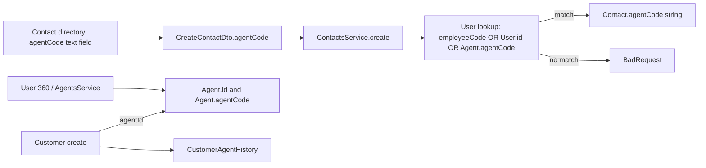
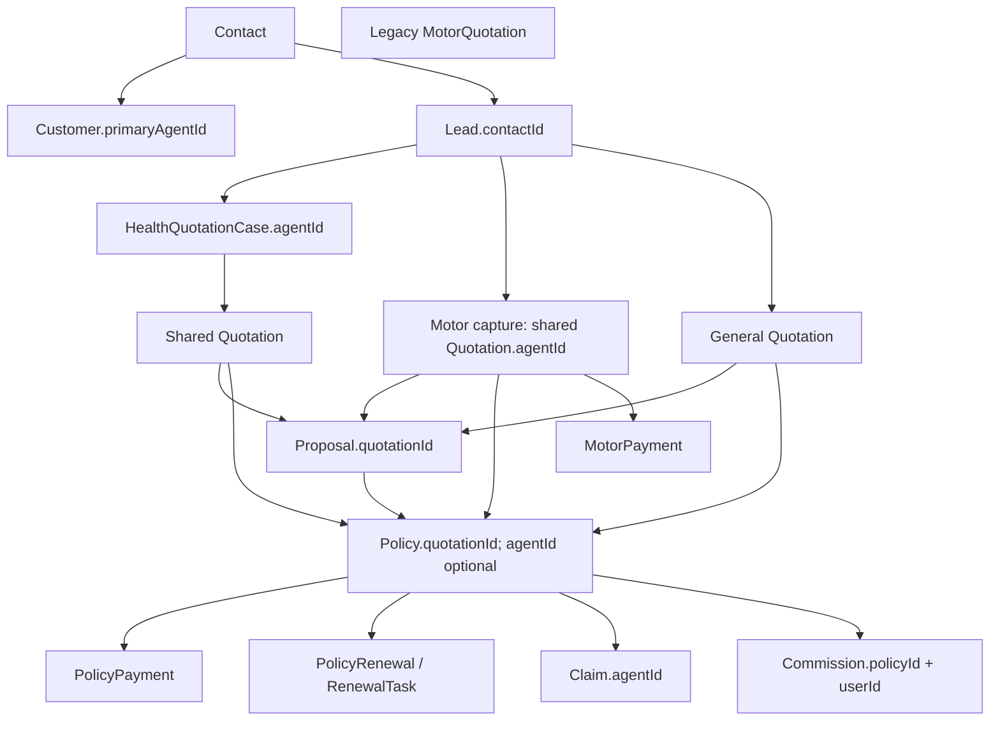

# M0 Discovery — Agent Identity, Agent 360, and Business Intelligence

**Date:** 2026-11-04
**Repository:** `UroojAKI/JEST-TECH-`
**Branch:** `feature/health-insurance-crm`
**HEAD:** `d8fce7a9937a5a1ca980c968c6a17a104f4c168e`
**Status:** Source discovery recorded; ready for M0 review. No new Agent Identity, Agent 360, or BI feature implementation has started.

This report is the M0 discovery checkpoint for the Complete Implementation & Execution Plan. HEAD was clean before this report was added; this report is the only current working-tree change. The commit contains the previously requested Health ownership and PII remediation. This pass inspected the current repository and its relevant source, schema, tests, contracts, and UI. It did not run a database migration or change business logic.

## 1. Repository and architecture map

| Layer | Existing implementation | Discovery notes |
|---|---|---|
| Workspace | pnpm 10.34.4 monorepo with root, `apps/api`, and `apps/web` packages | Root scripts use Turborepo; API is NestJS/Prisma and web is Next.js/React. |
| API composition | `apps/api/src/app.module.ts` registers agents, contacts, customers, CRM identity, leads, quotation, proposal, policy, claims, finance, analytics, BI, warehouse, dashboard, and workspace modules | Several metric/reporting modules are active at once; do not add a new BI module before their responsibilities are mapped. |
| Data | `apps/api/prisma/schema.prisma` | 161 models, 83 enums, and 37 migration directories at this checkpoint. Company is the tenant key. |
| API surface | 57 controller files under `apps/api/src/modules` | `docs/audit/baseline/api-routes.json` contains 428 route entries; the Nov. 3 contract report records 358 of 358 frontend calls matched, zero mismatches, and 224 backend routes without a detected frontend caller. The latter are investigation candidates, not proof of dead routes. |
| Web routes | `apps/web/src/app` | 88 `page.tsx` routes. The existing Admin User 360 route is `/admin/users/[id]`; the Agent workspace is `/workspace/agent`. |
| Tests | 140 API `*.spec.ts` files; existing browser tests use Vitest and Playwright is configured at the root | See baseline execution evidence in section 7. |

### Existing documentation and gaps

Relevant in-repository contracts include `DATA_OWNERSHIP_MODEL.md`, `DATA_TRUTH_RULES.md`, `ROLE_SCOPE_MATRIX.md`, `STATE_MACHINES.md`, `FINANCIAL_RULES.md`, `ARCHITECTURE_FREEZE.md`, `FRONTEND_BACKEND_CONTRACT_MATRIX.md`, `FEATURE_COMPLETION_MATRIX.md`, and the operations/release documents.

The plan names `01_PRD_Product_Requirements.md`, a TRD, SDD/SAD/DDD, API specification, security design, risk register, and test strategy. Those named artifacts were not found in the current repository. The available Architecture Freeze, Financial Rules, and State Machines are dated or labeled for `production-remediation`, not this target branch. They need reconciliation before their claims are treated as current implementation evidence.

Two binding constraints are clear in the current docs: `companyId` remains the tenant boundary, and the Architecture Freeze requires updating `DATA_OWNERSHIP_MODEL.md` before introducing a canonical entity. The requested external-code model therefore needs an explicit ownership-model update as part of M1.

## 2. Current identity and attribution architecture

### Canonical identities and identifiers

| Value | Current representation | Current use |
|---|---|---|
| Login identity | `User.id` | Authentication, creator/actor references, employee profile. |
| Employee code | `User.employeeCode` | Globally unique optional string. |
| Internal Agent identity | `Agent.id` | Canonical FK available on lead, customer, quotation, policy, claim, and Health case models. The current write paths do not populate every relationship consistently (see M0-ID-06). |
| Internal Agent code | `Agent.agentCode` | Company-unique code (`@@unique([companyId, agentCode])`). Generated sequentially by `AgentsService`. |
| Contact agent code | `Contact.agentCode` | Nullable string without an Agent FK or code-system namespace. |
| Motor quotation snapshot | `MotorQuotation.agentCodeSnapshot` | Historical/display string alongside optional `agentId`. |
| Customer owner | `Customer.primaryAgentId` | Optional FK to `Agent`; reassignment history is in `CustomerAgentHistory`. |
| External client code | No model or resolver found | Cannot be registered, verified, namespaced, or resolved to `Agent.id` today. |

There is no `AgentExternalCode`/equivalent registry, code-system table, identifier verification state, external-code audit history, or central agent identifier resolver. `CrmIdentityService` resolves contact/customer identity using contact ID, email, and phone; it is not an agent identifier resolver.

### Existing identity flow

The contact lookup uses a broad OR across identifier types. It does not accept a code-system namespace, and its lookup is against `User`, so the match does not itself establish an active canonical `Agent` profile. The persisted contact code is replaced with the matched profile code or employee code, so the original client code is not preserved as a separate identity.

The contact creation path also sets the contact's `createdBy` relation to `effectiveAgentId`, which is derived from the requested assigned agent when one is supplied. It separately sets `updatedBy` to the authenticated creator. This makes the creator/assignment distinction unreliable for audit and user-created portfolio counts.

### Customer-to-policy flow and attribution points

`Quotation` is the shared record written by the Health and current Motor capture commands; the schema and older service paths also retain a separate `MotorQuotation` model. Agent 360 and BI must account for both until their migration boundary and active consumers are reconciled. The Health case has an optional canonical `agentId`, but the Health quote builder does not copy it to the shared quotation.

The model relationships are not proof of end-to-end attribution. In the inspected write paths, Health and generic quotation creation omit `Quotation.agentId`; current Motor capture writes it. The generic policy issuer, Motor policy issuer, and proposal workflow adapter omit `Policy.agentId`. Claim creation copies `Policy.agentId`, so those issuance paths can leave claims unattributed as well. These are source-level findings; existing database row coverage remains unknown without a configured database.

The schema has multiple financial sources: `PolicyPayment`, `MotorPaymentRecord`, and finance payment/allocation services. `Commission` references `userId`, not `Agent.id`; the commission plan/rule surfaces include `CommissionPlan.rules` as JSON text and a separate `CommissionMatrix`. This must be reconciled before presenting agent-level financial totals.

`CustomerAgentHistory` records assignment rows with `agentId`, `assignedById`, `reason`, `assignedAt`, and `unassignedAt`. `CustomersService.assignAgent` uses a transaction, validates an active same-company target Agent, updates the customer with an optimistic `version`, closes the current history row, and adds a new row. It does not explicitly store previous and next Agent IDs in one event, external identifier snapshots, correlation ID, or an `AuditLog` row in that method. The existing history is useful and should be extended rather than replaced.

## 3. Existing APIs and UI surfaces

### API

| Surface | Existing routes / implementation | Scope and limitations to preserve or verify |
|---|---|---|
| Agent profiles | `GET /agents/me`, `GET /agents`, `GET /agents/:id`, `GET /agents/:id/stats`, `POST /agents`, `PATCH /agents/:id` in `AgentsController` | Agent profile CRUD and stats exist; no external code management/history endpoints. Routes are guarded and role-decorated. |
| Contact registration | `POST /contacts` with `CreateContactDto.agentCode` | Current code resolves employee code, user ID, or internal Agent code through a single OR query; no namespace or verified external alias. |
| Customer registration/reassignment | Customer create and assignment routes in `CustomersController`; `CustomersService` calls `CrmIdentityService.ensureLinkedContactAndCustomer` and writes `CustomerAgentHistory` | Customer uses canonical `Agent.id` for `primaryAgentId`; current default-agent behavior and customer attribution require review before alias integration. |
| Admin User 360 | `GET /users/:id/workspace`, plus separate `GET /users/:id/commissions` and `/incentives` | Admin/Back Office only. Existing API is the intended Agent 360 base, not a parallel profile API. |
| BI | `/bi/{conversion,revenue,loss-ratio,renewal,sales,growth,kpi}` and KPI definition management | Admin-only `BiController`; some calculations read separate payment stores. |
| Analytics | `/analytics/{leads,policies,claims,revenue,revenue/trend,renewals}` | Separate Admin/Back Office analytics services. |
| Dashboards | `/dashboards/{sales,sales-manager,renewals}` | Separate dashboard analytics service and warehouse facts. |
| Forecasting | `/forecasting/{revenue,renewals,customer-risk/:customerId}` | Separate forecasting module. |

These are active registered API surfaces. Their overlap does not alone establish duplication; metric ownership, formulas, data freshness, and consumers still need to be compared.

### Frontend

| Surface | Current behavior | Gap against requested scope |
|---|---|---|
| `/admin/users/[id]` | Profile, overview, work portfolio, activity/audit, tasks, organization/security, and commission/incentive tabs. Uses existing User 360 API and separate commission/incentive queries. | Recent lists are fixed at 20 records and the merged activity list at 40. No complete paginated proposal, payment, claim, or renewal portfolios. Existing portfolio aggregates mix Agent attribution with User creator/actor fields. |
| `/workspace/agent` | Agent/POSP management summary displays active agents, pending onboarding, and monthly premium. | It is not an Agent 360 portfolio. The active-agent count falls back to `activePolicies`; the pending-onboarding count is derived from inactive agents, so those labels can misstate the underlying measures. |
| `/crm/contacts` | Contact creation accepts an `agentCode` text value and locally matches it against user `employeeCode`, `agentCode`, or `id`. | UI matching is not authoritative and does not display a namespace or verified alias. The server currently persists a different internal code string. |
| `AgentSelector` in Motor Quote Wizard | Selects registered Agents or allows manual Agent entry. | Manual mode has no canonical Agent identity; the request can omit `agentId`. M2 must trace every manual field and snapshot before changing this workflow. |
| Admin agent editing | Agent data is currently available through Users/Agents surfaces; no external-code registry screen or identifier-history panel was found. | Add only after backend permission and data contracts are approved. |

## 4. Findings register

Findings below are confirmed by source inspection. Runtime/data reconciliation is not claimed.

| ID | Severity | Evidence and actual behavior | Business impact | Proposed correction | Minimum verification |
|---|---|---|---|---|---|
| M0-ID-01 | Critical | `apps/api/src/modules/contacts/services/contacts.service.ts`, `create`: `agentCode` resolves with `employeeCode OR User.id OR agentProfile.agentCode`; `Contact.agentCode` stores one internal code string. No namespace-aware external code model or resolver exists. | Client-defined code can collide with another identifier class, cannot be independently preserved or verified, and cannot be reliably migrated. | Add an additive company-scoped external identifier registry and one server-side resolver returning canonical `Agent.id`; preserve source code/system and reject ambiguous/unverified codes. | Duplicate/collision, namespace, inactive/unverified, cross-company, and alias resolution tests plus DB unique-constraint test. |
| M0-ID-02 | High | `ContactsService.create` assigns `createdBy` using `effectiveAgentId`, which is set from the requested Agent user; the authenticated actor is only `updatedBy`. `Contact.agentCode` is a string, while `Customer.primaryAgentId` is an Agent FK. | Creator, assigned owner, and code identity are conflated; audit and creator-based counts can be inaccurate. | Keep actor/creator separate from assigned Agent, preserve `createdById`, use canonical Agent relations for assignments, and retain legacy code snapshots only for display/history. | Unit and API tests asserting creator, owner, and actor remain distinct through contact/customer registration. |
| M0-ID-03 | High | `apps/api/src/modules/agents/agents.service.ts`, `autoProvisionAgent` and `create`: company code uses `count + 1`, followed by existence probes and insert. The DB uniqueness constraint is company+code, but concurrent creation has no retry around a uniqueness race. `findMe`/`findAll` swallow auto-provision errors. | Parallel provisioning can fail with a raw uniqueness error, and the caller may only see a later missing profile. | Use the existing sequence/numbering authority or another atomic allocation; handle uniqueness conflicts with bounded retry and expose provisioning failure. Do not silently treat failed provisioning as success. | Concurrent registration test against a database unique constraint; error-path test for auto-provision. |
| M0-ID-04 | High | `AgentsService.getAgentStats` counts leads by `Agent.id` and reads only the legacy `MotorQuotation` model. Current Motor capture writes to shared `Quotation`; the endpoint returns no shared Motor/Health quotations, policies, payments, claims, renewals, or commissions. | Existing Agent stats can miss current Motor capture and Health records and are not a complete product-neutral portfolio source. | Keep existing endpoint contract where possible; make Agent 360 aggregate authoritative common entities and product-specific records with explicit source semantics. | Fixtures for legacy MotorQuotation, current shared Motor quotation, and Health records; compare every metric to source rows. |
| M0-ID-05 | High | `CustomersService.assignAgent` has transactional versioned reassignment and `CustomerAgentHistory`; the history rows store the new Agent and time, not explicit from/to values or external-code snapshots, and that method does not emit an audit event. | Reassignment lineage is partly inferable from rows but insufficient for the requested immutable, attributable transfer record. | Extend the existing history path with an explicit auditable assignment event, including prior/next Agent, actor, reason, code references, timestamp, and correlation ID; retain prior transaction attribution. | Transaction rollback, concurrent conflict, history sequence, and audit event tests. |
| M0-ID-06 | Critical | Schema FKs exist, but inspected write paths are inconsistent: Health case creation stores `HealthQuotationCase.agentId` while its quote builder omits `Quotation.agentId`; generic quotation creation also omits it; current Motor capture writes `Quotation.agentId`. Generic policy issue, Motor policy issue, and `ProposalWorkflowAdapter` create Policy rows without `Policy.agentId`. `ReportClaimService` copies only `policy.agentId`. | Producing Agent attribution can be lost at quotation and policy creation, then remain absent from claims; schema-level joins will overstate completeness. | Carry the approved canonical Agent through each product's quote and issue command, preserve it on Policy, and keep creator/issuer separate. Reconcile existing rows before any backfill. | Unit and DB journey tests for Health, Motor, and general products asserting Agent continuity from case/lead through quote, policy, and claim, including separate creator/issuer IDs. |
| M0-360-01 | High | `UsersService.getUserWorkspace` and `/admin/users/[id]`: existing User 360 returns profile, counts, recent quotations/policies/leads, activities, tasks, and profile metrics. Recent lists are capped at 20 and activity at 40; proposals/payments/claims are not portfolio sections. Query predicates mix `agentId` with `createdById` or User IDs. | Reusing the page is appropriate, but current output is not a complete Agent 360 and mixes ownership with authorship. | Add an explicit Agent workspace contract using canonical Agent identity, separate attribution categories, and paginated/filterable portfolio sections. Preserve admin User 360 behavior for non-agents. | Admin/Back Office/Agent authorization tests, paginated source reconciliation for both products. |
| M0-360-02 | High | `UsersService.getUserWorkspace` sets `policiesIssued` to `Math.max(policy count, issued quotation count)`. | An issued quotation is not proof that a Policy row exists; the displayed metric may not match authoritative issued policies. | Use issued `Policy` records for policy counts and define quote-issuance status separately. | Fixtures with mismatched quotation issuance and policy records. |
| M0-BI-01 | Critical | BI exists in `business-intelligence`, `analytics`, `bi/dashboards`, `bi/forecasting`, and warehouse modules, all registered in `AppModule`. `BiService.getRevenueMetrics` sums `PolicyPayment` and `MotorPaymentRecord`; Motor query errors are caught and returned as zero, and timestamps differ (`paymentDate` vs `createdAt`). | Multiple dashboards can disagree; a failed Motor source can be silently undercounted; date semantics vary. | Create the metric dictionary first, map each controller/service/source/consumer, then select a single owner per metric. Fail visibly or mark partial data rather than silently replacing failed-source totals with zero. | Formula unit tests, integration reconciliation against both payment sources, error-path tests, and dashboard drill-down equality. |
| M0-BI-02 | High | `DashboardAnalyticsService.getSalesMetrics` receives `userId` from the controller and filters warehouse `FactRevenue.agentId` by that User ID; warehouse fact models use `agentId` without declaring whether it is `User.id` or `Agent.id`. The fallback reads policies by `createdById`. | Agent revenue may be missing or attributed to policy issuer/creator rather than canonical producing Agent. | Document and reconcile the dimension key; resolve the current Agent profile before querying agent facts and keep creator metrics separate. | Database fixture with distinct User and Agent IDs; verify fact join and drill-down. |
| M0-COM-01 | High | `PortalController` contains a fixed `amount * 0.1` commission calculation. In contrast, `CommissionEngineService` requires an active commission plan and blocks posting when one is absent; the User 360 page labels incentive rules `INC-B01` as awaiting executive approval. | A visible 10% figure can conflict with approved plan-based finance and is not a safe commission authority. | Remove competing interpretation only after tracing the consumer; use approved/versioned commission plans and do not invent or assume a rate. Obtain executive rule approval before M8. | Compare portal totals against approved commission engine rows and approved rule fixtures. |
| M0-DOC-01 | Medium | `ARCHITECTURE_FREEZE.md`, `FINANCIAL_RULES.md`, and `STATE_MACHINES.md` refer to the `production-remediation` branch and older dates. The ownership model omits Agent external aliases; in-repo named PRD/TRD and security/test plans are missing. | Stale contracts may contradict the target branch; the new entity requires data ownership and migration docs to be updated. | Reconcile binding docs to this branch before M1 schema approval; record decisions and unresolved business inputs. | Doc review tied to the approved M1 schema and metric dictionary. |

## 5. Backward-compatibility assessment

1. `User.id`, `User.employeeCode`, `Agent.id`, and `Agent.agentCode` are distinct existing values and must remain so. Client codes should be aliases of an `Agent`, not replacements for internal identifiers.
2. Keep `Contact.agentCode`, existing `MotorQuotation.agentCodeSnapshot`, quotation `agentId`, and customer `primaryAgentId` readable during rollout. Do not silently reinterpret existing code strings as external IDs.
3. Use additive schema and API changes. Preserve current `/agents`, `/contacts`, `/customers`, and `/users/:id/workspace` response behavior while clients transition to explicit identifiers and pagination.
4. Do not automatically change existing customers, quotes, policies, or commissions to a newly inferred Agent. Historical mapping requires a client-provided code catalogue and reconciliation report; unresolved values must remain unresolved.
5. Retain `CustomerAgentHistory` and current customer reassignment transaction semantics. Extend it or write an append-only assignment event; do not replace it with a parallel history table without proving necessity.
6. Keep Health and Motor attribution separate where their schemas differ, while resolving both to canonical `Agent.id` where authoritative relations exist.
7. Commission rates and incentives require approved business rules. Existing source and docs disagree, so no new formula is approved by this discovery.

## 6. Proposed implementation plan by milestone

The following is a proposed file-level plan, subject to review. Exact service boundaries may change after M1 schema and API design.

| Milestone | Candidate files and scope | Exit evidence |
|---|---|---|
| M1 — Identity schema and APIs | Update `docs/DATA_OWNERSHIP_MODEL.md`; `apps/api/prisma/schema.prisma` and additive migration; Agent identifier enums/models/history; extend `apps/api/src/modules/agents` with resolver, DTOs, controller/service, module registration and specs; use existing audit service. | Company/namespace/code uniqueness, canonical Agent resolution, permission checks, audit history, API contract and migration test. |
| M2 — Registration and attribution | `ContactsService`/`CreateContactDto`/module/specs; `CustomersService`/DTO/controller/specs; trace `LeadAssignmentService`, `MotorQuotation` and shared Quotation commands, Health case, proposal, policy issuance, claims, and commission entry points before editing each. Update contact directory and `AgentSelector` only after API contracts are ready. | Customer registration by external code maps to the correct Agent; actor/creator/assigned Agent remain distinct; Motor and Health preserve origin attribution; reassignment preserves history. |
| M3 — Historical reconciliation | Repeatable dry-run/backfill tooling and reconciliation report; only source mappings from an approved client code catalogue. | Duplicate, missing, inactive, and unresolved codes reported; no guessed mappings; staging counts reconciled. |
| M4–M5 — Agent 360 | Extend `UsersService.getUserWorkspace`, `UsersController`, `admin.repository.ts`, User 360 types and `/admin/users/[id]`; use paginated endpoints/queries for customer, lead, quotation, proposal, payment, policy, renewal, claim, commission, and activity portfolios. | Role-specific access and source-row reconciliations for every section, both products. |
| M6–M7 — Metrics, dashboards, Action Centre | Add metric dictionary and formula tests; reconcile existing `BiService`, analytics, dashboards, forecasting, warehouse facts, task, and notification services before selecting owners. Extend current dashboard UIs/routes rather than creating competing surfaces. | Approved definitions, source totals, date/attribution semantics, filters, drill-down equality, idempotent exceptions. |
| M8 — Commission | Inspect and extend `CommissionEngineService`, `CommissionPlan`, `CommissionMatrix`, commission routes/UI only after authorized rules are provided. | Versioned approved rules, eligibility, historical snapshots, reversals, financial reconciliation. No payout automation without separate authorization. |
| M9–M10 — QA and release | Unit, DB integration, API authorization, cross-module, browser E2E, security, performance, migration/rollback and release evidence. | Migrations and journeys verified in staging; independent re-audit and release approval. |

## 7. Existing baseline evidence and verification limits

The latest recorded execution on this source state was performed during the prior Health remediation checkpoint:

| Check | Result |
|---|---|
| API build / TypeScript | Pass |
| Web TypeScript | Pass |
| Web full Vitest suite | 16 files, 104 tests passed |
| API full Jest suite | 137 suites passed, 2 failed, 1 skipped; 1,178 tests passed, 9 failed, 1 skipped |
| API failures | All 9 were `connect EACCES 127.0.0.1` in health and metrics controller HTTP socket tests. |
| Database E2E | One persisted journey skipped; no E2E database configured. |
| Web production build | Previously blocked by `EPERM` creating `.next/server/app/admin`. |
| Tenant scan / mock-data scan | Passed in the prior checkpoint; these do not prove agent attribution, metric accuracy, or DB migration behavior. |
| Dependency audit | Registry lookup previously failed with `ENOTFOUND`; current advisory state is unverified. |
| Migration/staging | Not verified. Local `DATABASE_URL` is blank and Docker is unavailable in this environment. |

No staging/production data was accessed. The external client Agent code catalogue and approved commission/incentive rules were not present in the repo or supplied with this plan.

## 8. M0 gate and decisions for review

M0 source discovery is documented, but database and external-data verification remain unavailable. Before M1, review these proposed decisions:

1. **Canonical key:** `Agent.id` remains the only authoritative Agent FK; external codes are aliases scoped by company and code system.
2. **Namespace and normalization:** Define code-system identifiers and normalization rules per system. Do not assume all external codes are case-insensitive or normalize punctuation without the client’s rule.
3. **Code reuse:** Prefer retaining inactive code rows and preventing reuse of a company+namespace+normalized code until an explicitly audited transfer is approved. A partial active-only unique constraint would allow reuse but weaken historical attribution; confirm only if the client requires reuse.
4. **Assignment semantics:** Keep origin, current customer owner, servicing Agent, and creator/actor distinct. Customer reassignment changes current ownership but must not rewrite prior quote/policy attribution.
5. **Data inputs:** The client must supply the authoritative external-code list and namespace/source definitions before historical mapping. Executive approval is required for commission/incentive rules before M8.
6. **Environment:** Staging PostgreSQL plus a separate test DB are required for migration, uniqueness/concurrency tests, data reconciliation, and the end-to-end attribution journey.

**Gate status:** Ready for M0 review; M1 schema/migration work has not started under this new plan. The target plan calls for reviewing discovery/architecture before M1, so the next milestone depends on approval of the identifier model and migration approach.
